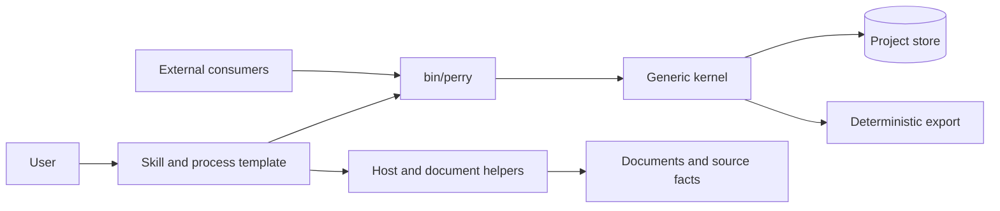

# Architecture — Perry

> Native architecture integrated through DESIGN-023 F/G/H. Local activation and
> actual named human V5 acceptance are recorded separately under
> `perry/evidence/2026-10/TASK-494-formal-cutover-20261020/FINAL.md`.
> This description does not replace those receipts or authorize another migration.
> Pre-cutover confirmed text remains in Git at b9be4d39f52ce1266534215b999c9db408b03bc5.

## §1. Mission & scope

Perry is a virtual project office for solo and small projects. The skill supplies
method and judgment; the generic kernel stores structured state. Markdown holds
narrative, evidence and user decisions. The kernel uses Python's standard library,
SQLite and a deterministic JSONL export. It runs without markdown or an agent.

The skill supports Claude Code, OpenCode and Codex CLI. Host helpers are optional
skill tools, with no new kernel capability. No server, model API or dependency is
introduced by the split. Project stores remain local to each project anchor.

## §2. Components

| Component | Responsibility | Contract |
|---|---|---|
| `bin/perry` | Single thin native entry point | imports `perry_kernel.main`; no dispatch aliases |
| `kernel/` | Generic items, types, fields, transitions, guards, relations, events and attachments | [kernel target](kernel/ARCHITECTURE.md); native `describe` |
| `SKILL.md`, `goals/`, `work/`, `decide/` | Routing, lane-specific `reference/` procedures and `templates/`, meaning, ownership and evidence decisions | lane procedures, [operating rules](reference/operating-rules.md) |
| `templates/process/` | Method as data | template format in native `describe` |
| `templates/scaffolds/`, `templates/internal/` | Standalone artifact starting points; root-owned workflow and policy templates | [template groups](templates/README.md); selected files only, no duplicate native state writer |
| `tools/` | Host helpers, document safety facts and architecture evidence | [tool contracts](tools/README.md), [helper shapes](tools/helper-contracts.md) |
| `release/` | Perry product versions, updates and publishing | [release rules](release/README.md) |
| `tests/`, `kernel/tests/` | Native/helper correctness and isolated integration | [suite definition](tests/README.md) |
| `perry/`, `.perry/` | Historical project documents and local configuration/evidence | historical inputs and current owned narratives kept distinct |

The old `viewer/`, `schema/` and typed-state tools are removed. The viewer's
[retirement note](release/retirement/viewer.md) and exact finite source inventory
remain under [the H ledger](release/retirement/README.md); actual approvals and
consumer verification are separate cutover receipts.

Shared procedures and the native caller contract live under `reference/`.
Lane-only details remain with that lane; software artifact templates remain with
the pack. Physical template location does not grant authority to write output.

## §3. Boundaries & dependencies

Allowed: skill and external consumers → native CLI → kernel → store. Helpers
that need structured state call the native CLI with explicit roots. They do not
open SQLite or fold native exports. Architecture tools analyze source as data,
never execute analyzed code. Release tooling is separate product infrastructure.

Forbidden:

- The kernel imports no skill/helper/release module, reads no markdown and runs
  no command. Its eight concepts and existing command/guard budgets do not grow.
- A helper must not become a hidden compatibility command in `bin/`, retain a
  legacy state writer, or copy the old full viewer parser into the skill.
- A figure about current structured state must come from native query/metric
  output. The skill chooses recommendations and records uncertainty explicitly.
- No caller invents actor identity, human acceptance or independent review.
- Roots and stores are explicit in tests. `PERRY_KERNEL_TESTING=1` prevents an
  omitted test store from using the shared live store.

The old single-viewer-parser and JSONL projection rules are replaced by the
kernel's store/export boundary. This is a visible target change under DESIGN-023,
not an author-certified compliance result. Historical documents are retained.

## §4. Data flow

Each project anchor resolves one store shared by its worktrees. The skill applies
the process template and uses item/relation/attachment operations. Native queries
return counts, blockers and metrics. Documents are attached as evidence, never
folded into current item state. Exports are backups and review surfaces; they are
not replication. Import is into an empty store only.

Before reading current project state, run the skill's recovery and interrupted-run
procedure. A legacy transaction marker blocks migration; use a pinned pre-cutover
release to recover it. Never delete it or silently resume a dossier.

## §5. Contracts

`bin/perry describe` is the native versioned argument/result contract. Every
native result is an envelope. Unknown arguments/keys refuse; help does not execute.
A refusal never authorizes direct edits to the store, an export or a legacy file.

Host helper contracts are versioned separately in `tools/helper-contracts.md`.
They replace the retired `schema/*-contract.md` payloads. Actual aiMark native
consumer reads were verified during cutover. Future migrations still require
consumer verification; the prior result does not accept an untested change.

## §6. Non-negotiables

1. Structured state is owned solely by the kernel. No helper opens its database.
2. Deterministic tools judge shape and facts; evidence adequacy and document meaning
   remain with the skill, an independent reviewer and the actual user.
3. A command never reports a write it did not perform. Structural success is not
   acceptance. No-op and refusal remain distinguishable.
4. Tests use temporary roots/stores and check source-tree integrity on every suite
   exit. Integration tests run a disposable merge of immutable local refs.
5. Lane ownership, high-stakes screening, recovery/interrupted gates, evidence,
   reviewer freshness and named human sign-off are retained. Safety gates cannot
   be dropped. Document helper output does not authenticate consent.
6. Agents may describe architecture; changing a confirmed mission, Forbidden rule,
   contract version or hard target requires the user's actual decision before it
   lands. Candidate text and fresh static receipts do not supply that decision.
7. Do not self-merge. A coding-branch green is not independent combined-tree green.

## §7. Cutover record and verification boundaries

F/G/H source integration, both project activations, aiMark native reads and the
actual user V5 are complete in the dated cutover record. Its full/slow, replay,
backup, independent-review and acceptance receipts define the verified scope.
The finite retirement ledger retains its original proposal labels for provenance;
those labels do not supersede the separately recorded actual user decisions.

Future integrations still require independent combined-tree verification and any
applicable user approval. Source descriptions and static architecture freshness
alone establish neither semantic acceptance nor full architecture coverage.
Public release, GUI acceptance and future project migrations are separate actions.

## §8. Evidence

The H ledger names the immutable source base, per-file SHA256, exact path mapping,
check dispositions and real red demonstrations. Architecture start/delivery bundles
are durable outside the executor checkout; their static limits remain visible.
Tests/run's new suite is not a claim that the retired legacy full/slow corpus passed.
