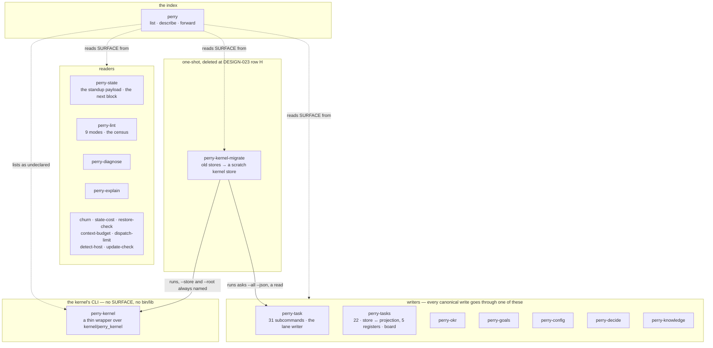
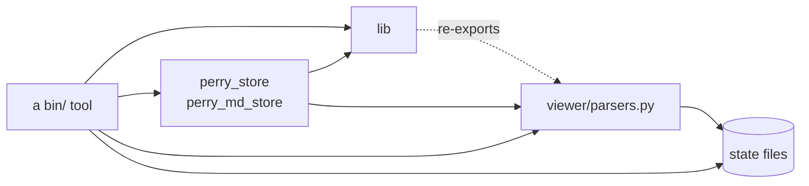
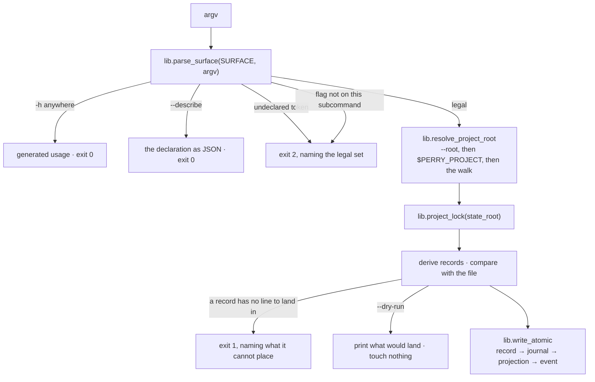

# Architecture — `bin/`

> Written by: agent · Confirmed by: user (§6, §7)
> Version: v1
> Last reviewed: 2026-10-07
> Module document for the `bin/` component. The project's is [`ARCHITECTURE.md`](../ARCHITECTURE.md) § 2.
> Cap: ≤ 600 lines. This describes the directory's structure, not its usage — usage is `bin/README.md`, and `bin/perry list` is the generated index.

## §1. Mission & scope

Twenty-two executables (the index `perry`, `perry-kernel`, the `kernel/` CLI's thin wrapper, and `perry-kernel-migrate`, DESIGN-023 row D's one-shot importer, included) and three libraries. Everything Perry reports as a number
is computed here, and every write to a canonical file goes through here.

The rule the directory exists to enforce: **a number Perry reports must be
computed, never eyeballed.** An agent that reads `perry-tasks board` and counts
blocked rows is right most of the time, and the times it is wrong are invisible.

It decides one thing about what to do, and only from a declared table:
`perry-state --section next` evaluates `reference/next-rules.json` over the
payload it computes and returns the next-step recommendation that the lanes
render. That is the user's decision,
`perry/design/DESIGN-020-guided-planning.md § 9`, the 2026-09-15 entry,
confirmed by the user in session. Beyond that it does not decide what to do. It
does not call a model, with one named exception. It does not judge what a
document means.

## §2. Components

### Static code architecture browser

`perry-architecture` reads an arbitrary directory without adopting it into
Perry. `perry_architecture/scan.py` uses Python AST to produce file and import
facts, including extensionless Python scripts. `report.py` packages the same
payload with local HTML/CSS/JS for an offline report. The command writes only
an explicitly named, new report outside the analyzed project; JSON defaults
to stdout. It neither imports target code nor reads or writes project state.
The analyzer does not depend on `viewer`, `lib`, or the state kernel; only
the CLI delegates argument parsing and discovery to `lib`'s surface helpers.
See [scope and acceptance](perry_architecture/README.md).

### The three state libraries

| Module | Lines | What it holds |
|---|---|---|
| `lib/__init__.py` | 2,169 | primitives every tool needs: the project-root resolver, the argument parser driven by a `SURFACE` declaration, the project lock, atomic writes, the schema loader, KR progress |
| `perry_store.py` | 2,237 | the record shape, the store-only board render behind `perry-tasks board`, and the renderer and `--from-board` importers for a `BOARD.md` a project still holds |
| `perry_md_store.py` | 1,806 | the same pair for documents keyed by heading — `OKR.md` today |

### What `perry-context-budget` reads outside the project

It reads host transcripts, not Perry state, read-only: `~/.codex/sessions/`,
located by the session id Codex exports, and a Claude transcript only when a
caller names it with `--session` (Claude's exported id cannot be bound).
To learn which host it is under, it runs `bin/perry-detect-host` as a
subprocess (10 s timeout; a failure reads as `unknown`) and depends only on
that script's one-token output. It and `perry-kernel-migrate` (below) are
the two `bin/` tools that execute another tool. Each runs it as a
subprocess and imports nothing from it: this one runs `perry-detect-host`,
and the importer runs `perry-kernel` and `perry-task`.

### What `perry-kernel-migrate` runs and writes

DESIGN-023 row D's importer (TASK-489). What it reads, and through what:
- the old stores: `perry_store.load_board_stores`, with the state root from
  `parsers.resolve_state_root`;
- `.perry/events.jsonl`: `parsers.load_register_store`;
- a status cell: `parsers.ask_is_answered`, `parsers.ask_answer` and
  `parsers.status_is_cleared`; a blank cell: `lib.is_blank_cell`; a time:
  `lib.ts_moment`;
- an ask's `Blocks` ids: `perry-task asks --all --json`, run as a subprocess
  with `--root` set to the project, and only when the project holds an ask.
  Its `blocks_ids` are `perry-task § _BLOCKS_ID`'s reading of each cell. The
  importer holds no split of its own: a task's `depends_on` entries are taken
  whole, as `tasks.jsonl` holds them (`perry-task § parse_depends` output).
  That read must change no file under the state root or `.perry/`, or the
  import stops. It takes the project lock, a file in the system temp
  directory, as every `perry-task` command does;
- a key-result id: the id pattern `schema/state-schema.json` declares for a
  `kr` record of `linkage.jsonl`, through `lib.load_schema`, as `perry-goals`
  reads it;
- `templates/process/perry.json`, the process template, as data: the types,
  fields and transitions it maps onto, and the template its export applies.
  That file is not a state file.

Before it reads any store, it refuses a project whose state root holds a
pending `perry-task` recovery marker, as `parsers.scan_recovery` reports one,
whether or not the project has asks.

Without `--work` it only plans: it writes nothing itself, and the
`perry-task asks` read above is the only command it can run. With `--work`,
it writes a synthetic kernel export under that directory, which must be
empty or absent, and outside the project and any `.git`. It then runs
`bin/perry-kernel import`, `query`, `item create --dry-run`, `export` and
`events` as subprocesses, each naming `--store <work>/store.db` and
`--root <work>/anchor`. It writes nothing in the project itself. If a file
under the project changes across its `perry-task asks` read, the most likely
cause is a pending recovery marker that appeared after the check and that the
read completed; the importer names the file and stops before anything is
imported. Row H deletes it with the rest of this directory; the mapping it
applies is `bin/README.md § perry-kernel-migrate`.

### The one tool that reaches outside

`perry-codex-preflight` shells out to `codex exec` to check the CLI answers
before a dispatch depends on it. It is the only tool here that depends on
`codex` and the only thing here that touches a model.
`perry-context-budget` also reads outside the project — host transcripts, above
— and runs one program, `bin/perry-detect-host` through `bash`; it calls no
model. It is also the one tool in `bin/`
with a recorded NN-1 exception: it reads one key of `.perry/config.jsonl`
itself (root §6 NN-1, USER-971).

## §3. Boundaries & dependencies

Rules, each with a scar behind it:

- **A tool never parses a state file itself.** `parsers` is the reader; `lib`
  re-exports `resolve_state_root` from it rather than holding a second body.
  The one recorded exception in `bin/` is `perry-context-budget`'s config read
  (root §6 NN-1; `release/manage.py` holds the other, outside `bin/`). Not the only direct read: on 2026-09-21 an architecture re-review
  found `perry-lint` reading `asks.jsonl`, `perry-tasks` reading `tasks.jsonl`
  and `perry-task` reading `okr.jsonl` themselves. None is recorded as an
  exception, and whether each is an NN-1 parse is not yet decided.
- **A tool never imports another tool** — except `perry-tasks` and `perry-task`,
  which load each other as modules through one cached loader, because the board
  writer and the store renderer must be the same function.
- **`lib` imports no tool.** It is the bottom.
- **The lock spans the read, the decision and the write.** Taking it only around
  the rename still lets a concurrent writer decide against stale bytes.

## §4. Data flow — what happens to one command

The refusal branches are the point of the diagram. Three of them were added by
`DESIGN-016` after each had been measured as a silent success.

`perry-kernel` does not take this path: it parses, resolves, locks and refuses
as [`kernel/ARCHITECTURE.md`](../kernel/ARCHITECTURE.md) § 4 describes.

## §5. Contracts

### The declaration — `SURFACE`
Every converted tool carries one: `name`, `kind`, `summary`, `root_resolution`,
`exit_codes`, `flags[]`, and `subcommands[]` with per-subcommand flag lists.
It drives the parser, `--describe --json`, the generated usage block and
`bin/perry list`. Seven tools declare one (`perry-config`, `perry-diagnose`,
`perry-kernel-migrate`, `perry-okr`, `perry-state`, `perry-task`,
`perry-tasks`); fourteen do not, and `perry list` says which.

### The registers — `perry-tasks`
Five verbs (`build verify write render diff`) over five registers (tasks,
risks, intake, asks, cadence), plus `board`, which prints all of them without
reading `BOARD.md`, and the
register is a parameter: `--register risks` is `risks-build`. The register list
is read from `schema/state-schema.json § claims` — the `work`-owned stores — so
a fifth store gets the verbs without an edit here. `render`, `diff` and `verify`
act on a `BOARD.md` a project still holds and refuse where there is none; no
command creates one (TASK-237 3c). That file is retired (TASK-262): `write
--from-board` and the `*-write --from-board` imports (and `perry-task
risk-migrate`) are the only readers left, `render`/`diff`/`verify` stay until
R5, and `board` names a held file on stderr as one that can be deleted.

### Exit codes
`0` read or written · `1` refused, reason printed · `2` bad invocation ·
`3` the bytes match and the store did not produce them. These are the other
tools' codes: `perry-kernel`'s `3` is an internal fault, rolled back
(`kernel/ARCHITECTURE.md` § 5.1).

## §6. Non-negotiables

### NN-B1 — `--help` never runs anything
- **Severity**: hard
- **Rule**: `-h` / `--help` in any argument position prints and exits, before
  dispatch and before any lock.
- **Rationale**: `perry-tasks render --write --help` used to run the render.

### NN-B2 — An undeclared token is refused, never ignored
- **Severity**: hard
- **Rule**: a token starting with `-` that the declaration does not carry exits
  2 and names the legal set. So does a declared flag on a subcommand that does
  not list it.
- **Rationale**: `--wrte` printed a render, wrote nothing and exited 0.
  `--design` and `--kr` were each accepted by a flat flag table and dropped by
  the handler.
- **Check**: `bash tests/run --only test_bin_surface`

### NN-B3 — One resolver, one order
- **Severity**: hard
- **Rule**: `--root`, then `$PERRY_PROJECT`, then the walk up. One
  implementation, `lib.resolve_project_root`. `perry-diagnose` passes
  `walk=False` because it judges the directory it is pointed at.
- **Rationale**: three tools had the order inverted and two of them write; a
  write landed in a project the caller did not name.
- **Sunset (proposed, DESIGN-023)**: carried from root `ARCHITECTURE.md` § 3, the
  third Forbidden line, in the same words. This becomes false at DESIGN-023 § 6
  row H. The kernel's resolver (`kernel/ARCHITECTURE.md` § 5.7, NN-K5) is the
  second implementation DESIGN-023 introduces. It walks in the same order as
  `bin/lib § resolve_project_root` with a different predicate — it stops at the
  first `.perry/`, not the first installed project — and it refuses
  (`anchor_not_found`) where `bin/lib` falls back to the working directory or
  takes a `--root` or `$PERRY_PROJECT` that holds no `.perry/`.
  `kernel/tests/test_resolver_agreement.py` pins those four differences on both
  sides and shows the two agree on a shared set of fixture roots. The copies
  that already exist are unchanged and go at row H: `bin/perry-state §
  resolve_root`, `viewer/parsers.py § _resolve_project_root`, the flag/env/cwd
  lines in `perry-decide`, `perry-task`, `perry-knowledge`, `perry-state-cost`,
  `perry-context-budget` and `perry-explain`, `bin/perry-churn § detect_perry`,
  which walks up to the first `.perry/`, stops at the git top level, and takes
  no `--root` and no environment variable, and `perry-lint`, which reads
  no `$PERRY_PROJECT` at any of its nine sites: one, the default lint, walks,
  and eight per-mode branches (`--claims`, `--verification`, `--summaries`,
  `--glossary`, `--reviews`, `--knowledge`, `--provenance`, `--specs`) take
  `--root` or else the cwd, with no walk.

### NN-B4 — A tool's own document is short
- **Severity**: soft
- **Rule**: `--help` is usage first, generated from the declaration. The
  argument for a refusal lives in `bin/README.md § The argument, per tool`.
- **Rationale**: `perry-task --help` was 10,690 bytes with `Usage:` at line 51,
  so an agent asking what `done` takes paid ~2.5k tokens for fifty lines of
  history.

## §7. Open questions

- **OQ-B1 — The other fourteen tools.** Six declare a `SURFACE`. Converting the
  rest is mechanical but not free, and `perry list` reports them as undeclared
  in the meantime. No row is open for it.
- **OQ-B2 — Should `perry-task` be split?** 9,069 lines and 31 subcommands against `perry-okr`'s 68. The subcommands cover five different objects
  (tasks, risks, intake, asks, cadences); `DESIGN-016 § 1.4` records the option
  of redrawing the tools by object and does not take it.
- **OQ-B3 — What keeps this file true?** Nothing does yet. The project
  document's §7 asks the same thing about the module contract.

## §8. Change log

- 2026-10-09 · v1 · TASK-489 round 6: § 2 "What `perry-kernel-migrate` runs and writes": the importer refuses a pending `perry-task` recovery marker (`parsers.scan_recovery`) before it reads any store, asks or no asks; a file changed across its `perry-task asks` read is "most likely" such a marker; the overlong line is rejoined. §§ 1, 3–7 unchanged.
- 2026-10-09 · v1 · TASK-489 round 5: § 2 "What `perry-kernel-migrate` runs and writes" no longer says it never writes the project. It names the one case: the `perry-task asks` read completes a pending `perry-task` recovery marker, and the importer names the changed file and stops. §§ 1, 3–7 unchanged.
- 2026-10-07 · v1 · TASK-489 round 4, the user's option B: § 2 "What `perry-kernel-migrate` runs and writes" lists what the importer reads and runs. It holds no split of its own: an ask's `Blocks` ids come from `perry-task asks --all --json`, run as a subprocess, and `depends_on` entries are taken whole. A key-result id is read by the schema's declared `kr` id pattern. The work directory may be empty or absent. § 2's "two tools that execute another" names what each runs, as a subprocess; the diagram gains the importer's edge to `perry-task`. §§ 1, 3–7 unchanged.
- 2026-10-07 · v1 · TASK-489 round 3: § 2 "What `perry-kernel-migrate` runs and writes" names the other readers the importer uses (`parsers.ask_answer`, `parsers.kr_objective_id`, `lib.is_blank_cell`, beside the two status predicates) and says it reads `templates/process/perry.json` as data. §§ 1, 3–7 unchanged.
- 2026-09-29 · v1 · TASK-489: `perry-kernel-migrate`, DESIGN-023 row D's one-shot importer, joins the directory. § 1 counts twenty-two executables; § 2's diagram gains it and its one run edge to `perry-kernel`, § 2 says it and `perry-context-budget` are the two tools that execute another, and a new subsection says what it runs and writes; § 5 counts seven tools that declare a `SURFACE`. § 7 OQ-B1 still says "Six declare a `SURFACE`": that section is the user's, so its count waits for the user.
- 2026-09-26 · v1 · TASK-488, decided by the user on 2026-09-26: § 6 NN-B3's sunset, like root § 3's third Forbidden line, adds `bin/perry-churn § detect_perry` (`:305–341`) to the existing copies — it walks up to the first `.perry/`, stops at the git top level, and takes no `--root` and no environment variable.
- 2026-09-26 · v1 · TASK-487 round 4, decided by the user: § 6 NN-B3's sunset, like root § 3's, names `perry-lint`'s nine sites exactly — one walks, eight per-mode branches take `--root` or else the cwd — in place of "flag-then-walk".
- 2026-09-25 · v1 · TASK-487 (rounds 2 and 3): `bin/perry-kernel` joins the
  directory. § 1 counts twenty-one executables and § 5 fourteen tools without a
  `SURFACE` (round 2); § 2's diagram gains `perry-kernel`; § 4 and § 5 say it
  follows `kernel/ARCHITECTURE.md` § 4 and § 5.1, so its exit 3 is an internal
  fault; § 6 NN-B3 carries root § 3's proposed sunset in the same words, and
  § 7 OQ-B1 counts fourteen — both decided by the user.
- 2026-09-21 · v1 · correction (re-review 2): § 2 said `perry-context-budget`
  "runs no external program" — it runs `bin/perry-detect-host` through `bash` —
  and listed `git` among `perry-codex-preflight`'s dependencies — it runs none,
  and several other tools here do. Both corrected. (An earlier wording gave a
  count; two greps disagreed on it, so the text carries none.)
- 2026-09-21 · v1 · correction: § 2 said `perry-context-budget` is "the one
  tool that reads a state file itself", which the re-review showed untrue; it is
  the one with a recorded exception. § 3's rule now names that exception and the
  three unrecorded direct reads the re-review found.
- 2026-09-21 · v1 · USER-978: § 2 "The one tool that reaches outside" names
  `perry-context-budget`'s outside reads and its direct config read (NN-1 Known
  exception, USER-971). The 2026-09-18 rewrite of § 2 "What
  `perry-context-budget` reads outside the project" (TASK-471, `6bb4dc6f`) had
  no entry here; this is it.

- 2026-09-15 · v1 · TASK-442: §1 records that `perry-state --section next`
  owns the next-step recommendation, evaluated from `reference/next-rules.json`
  (`perry/design/DESIGN-020-guided-planning.md § 9`, 2026-09-15). §2's
  `perry-state` node names the next block.
- 2026-09-14 · v1 · TASK-237 3c: this repository holds no `BOARD.md`. §1 names
  `perry-tasks board` as the board a reader counts from; §2's `perry_store.py`
  row and §5's registers say the render, diff and verify verbs act only on a
  board a project still holds.
- 2026-09-14 · v1 · Descriptive refresh, measured on main:
  - 20 executables;
  - `perry-task` 31 subcommands, `perry-tasks` 22 (five registers, with
    `cadence` from TASK-237 3b, plus `board` from TASK-237 D1);
  - library line counts;
  - the six SURFACE-declaring tools named;
  - OQ-B2's sizes.
  `BOARD.md` in §1 stays true until TASK-237 3c deletes the file.
- 2026-09-09 · v1 · Written with `DESIGN-016` phases A–D landed: the argument
  contract, the declaration, the index and the register parameter are all in
  the diagrams above because they are what changed the directory's shape.
