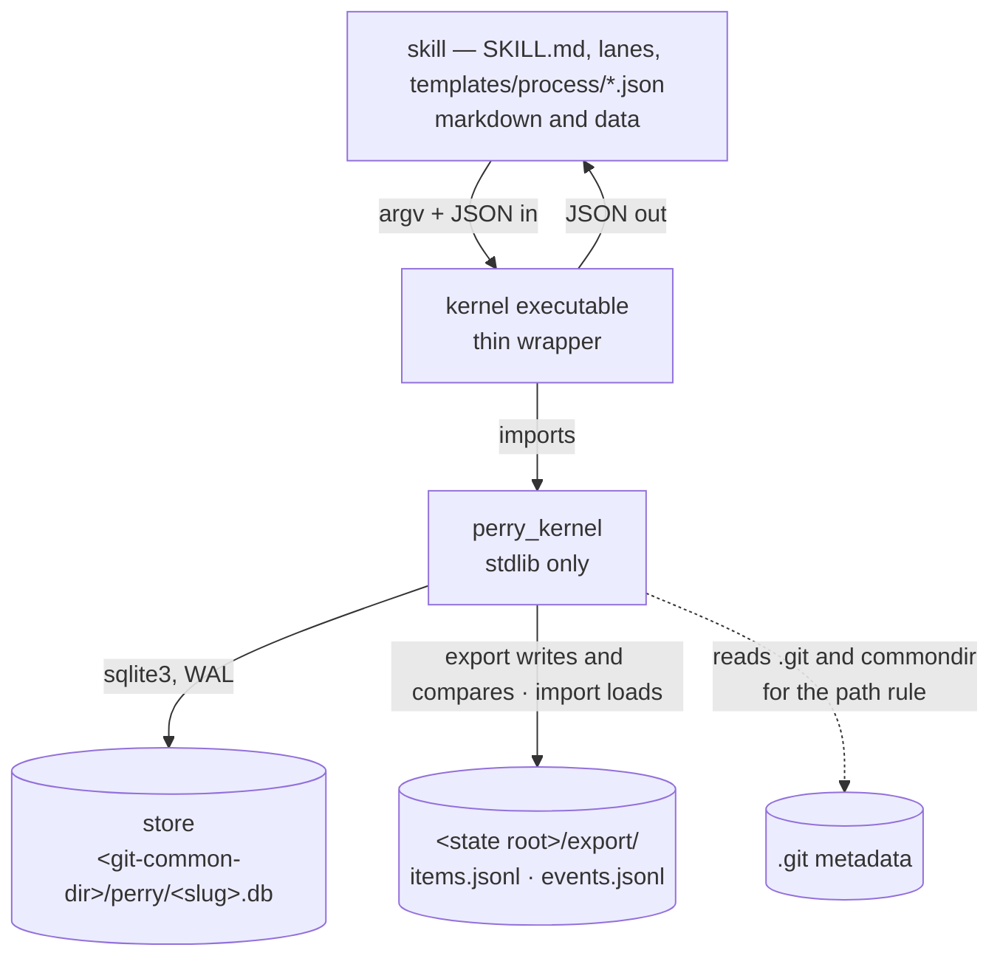
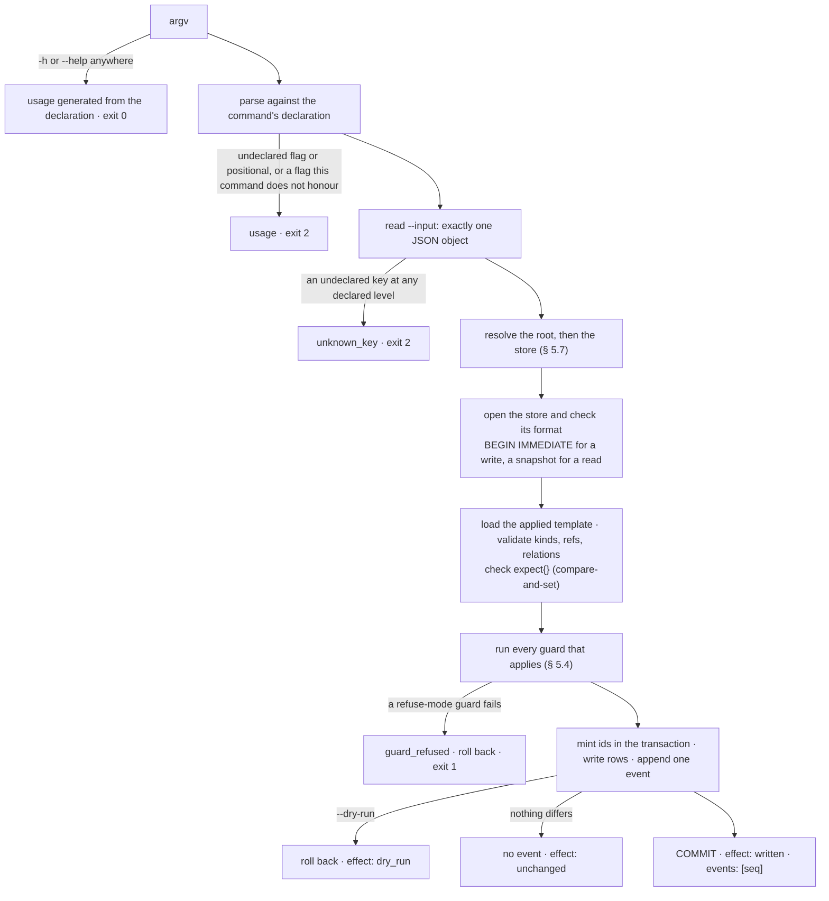

# Architecture — `kernel/`

> Written by: agent · Confirmed by: —
> Version: v1
> Last reviewed: 2026-09-29
> Module document for the `kernel/` component. [`ARCHITECTURE.md`](../ARCHITECTURE.md) § 2 names it; the user confirmed that entry on 2026-09-24 (merged in 34d7be63).
> Cap: ≤ 600 lines. This is the kernel's specification, written before any kernel code exists (DESIGN-023 § 6 row A). The design it specifies is `perry/design/DESIGN-023-a-kernel-and-a-skill.md`.
> Overflow → split per-§ to `architecture/sections/§<N>-<topic>.md`, the root document's convention under `kernel/`. § 5 is split out.

## §1. Mission & scope

The kernel holds a project's structured state and applies the structural rules that a
process template declares. It is stdlib-only Python behind one CLI, and every command takes
JSON and returns JSON. The skill (markdown) calls the kernel. The kernel never calls the
skill.

The kernel knows eight concepts (§ 2) and no method. Every item type, state, field,
transition and guard comes from the template, which is data that the skill ships. The names
in this document's examples (`widget`, `gauge`, `queued`, `bench`, `inspector`) are
invented and mean nothing to the kernel. DESIGN-023 Goal 1 applies to this document as it
does to the code.

It deliberately does **not** read, parse, lint or render markdown (Goal 2). It does not run
a command or spawn a process (decision 8), judge what a document means (decision 3), or
recommend a next step (decision 5). It does not serve several users, run a server, sync
machines or draw a UI (§ 3 Non-Goals). Status: built by DESIGN-023 § 6 row B; `bin/` stays
the live writer until each lane cuts over, and row C writes the first template.

## §2. Components

### The eight concepts (Goal 6)

| Concept | Fields |
|---|---|
| **Template** | `format` (the kernel's template-format version, `1`), `name`, `version` (a positive integer that only rises), `types{}`, `relations{}`. One version is applied at a time, and applying one is an event (§ 5.2) |
| **Item** | `id` (minted from its type's prefix), `type`, `state`, `fields{}` (every declared field, `null` when unset), `seq` (the seq of the last event that touched it), `created_at`, `updated_at` |
| **Field** | declared per type: `kind` is one of `text` `int` `number` `date` `enum` `actor` `ref` `list` `metric`, plus that kind's options (§ 5.3). Its value lives on the item |
| **Transition** | declared per type: `name`, `from` (one or more states), `to` (one state), `guards[]` |
| **Guard** | `kind` (`required` · `actor` · `relations_closed` · `limit`), the kind's keys, and an optional `when` (§ 5.4). Guards run on create and on transitions |
| **Relation** | `kind`, `from`, `to`. The built-in kinds are `blocks` (*from* blocks *to*) and `parent` (*to* is the parent of *from*). The template can declare others |
| **Event** | `seq`, `at`, `actor`, `command`, `items[]`, `transition`, `changes[]` (each with a `key` and its `before` and `after` values), `note`, `warnings[]`. Events are append-only and are the store's history (ADR-022) |
| **Attachment** | `item`, `ref` (a path or URL, kept verbatim), `hash` (optional, `sha256:<hex>`). The kernel never opens the target |

`startable`, `blocked_by`, a metric's `met` and `fraction`, and an item's `rollup` are
derived when read and never stored (§ 5.5, § 5.6).

### Layout (DESIGN-023 § 5.5)

`kernel/` holds the `perry_kernel` package, its tests and this file. The executable,
`bin/perry-kernel`, is a thin wrapper of a few lines that imports `perry_kernel` and calls its
`main()`; the user named it on 2026-09-24 (OQ-K6), and row H renames it `bin/perry`. The
package is cached as bytecode, so nothing is recompiled per call. This document writes `kernel`.

### The budget

**8 concepts** (the eight above) and **at most 12 command groups**. Ten groups are in use:
`init`, `template`, `item`, `rel`, `attach`, `query`, `events`, `export`, `import` and
`describe`. There are also **exactly 4 guard kinds and 9 field kinds**. A fifth guard kind
or a tenth field kind is a concept change (DESIGN-023 § 3, § 7).

**How a test checks it.** `describe` reports `concepts`, `budget`
(`{"concepts": 8, "command_groups": 12}`), every command, and the template format's
`field_kinds` and `guard_kinds`. The kernel suite asserts that `concepts` is exactly the
list above, that `commands[].name` has at most 12 distinct first words, that there are 4
guard kinds and 9 field kinds, and that `budget` equals the test's own literals, 8 and 12.
The test does not read this file, because the kernel suite must pass with every `*.md`
removed (Goal 2). Raising a number means editing both the test literal and this section,
and DESIGN-023 § 7 makes that a revision of the design, not a new row.

## §3. Boundaries & dependencies

Allowed directions: skill → kernel → store. There are no others.

Forbidden:
- **Importing anything outside the stdlib and `perry_kernel`**, `bin/`, `viewer/` and
  `release/` included. **Reading markdown**, in any mode (the suite runs with no `*.md`).
- **Running a command.** The kernel makes no `subprocess`, `os.system`, `os.exec*` or
  `os.spawn*` call. It finds the git common dir by reading `.git` and `commondir` (§ 5.7).
  The skill runs a measurement's command and writes the value (decision 8).
- **Naming a skill path or a template-declared name.** Goal 1's test greps the kernel
  source for every type, state and field name in the shipped template as a string literal
  (`"name"` or `'name'`), case-sensitively. A collision is fixed by renaming on the kernel's side.
- **Any other path.** The kernel reads only its store, its `--input` file, the `.git`
  metadata and the export. It writes only the store and `<state root>/export/`. Only
  `import` loads the export; `export` reads its own files only to tell `unchanged` apart.

## §4. Data flow — what happens to one command

One command is one transaction. A refusal after `BEGIN` rolls back the whole transaction,
including the relations and attachments written by the same `item create`, so an edge made
at create cannot half-land (DESIGN-015 § 5.3). An unexpected exception is caught at the
top, rolled back and reported as `internal`. No traceback reaches the caller (NN-K6).

## §5. Contracts

Split out whole on 2026-09-26 (TASK-488), under the overflow convention in the header, to
[`architecture/sections/§5-contracts.md`](architecture/sections/§5-contracts.md). It holds
5.1 the envelope, exit codes and error codes · 5.2 the process template, format 1 ·
5.3 field kinds · 5.4 guards · 5.5 metrics and the roll-up · 5.6 commands · 5.7 the store ·
5.8 export and import · 5.9 the argument for each new claimed path. Every `§ 5.x` in this
document, and every `kernel/ARCHITECTURE.md` § 5.x elsewhere, means that file's subsection.

## §6. Non-negotiables

Every rule below is **proposed** (NN-6), and none of them binds until the user confirms it.
NN-K3 to NN-K8 restate DESIGN-016's argument-contract lessons as rules of this CLI.

### NN-K1 — The kernel knows no method
- **Severity**: hard · **Status**: proposed
- **Rule**: kernel source names no skill path, and no type, state or field that the
  shipped template declares (Goal 1).
- **Check**: the grep test in § 3, and the kernel suite run with every `*.md` removed.

### NN-K2 — The kernel runs no command and reads no markdown
- **Severity**: hard · **Status**: proposed
- **Rule**: no process is spawned, whether for a metric or for the git path rule. No
  markdown file is opened.
- **Check**: a source scan for the process calls listed in § 3, and the markdown-free run.

### NN-K3 — `--help` never executes
- **Severity**: hard · **Status**: proposed
- **Rule**: `-h` or `--help`, in any argument position, prints the generated usage and
  exits 0, before the root or store is resolved, `--input` is read, or any lock is taken.
- **Rationale**: DESIGN-016 goal 2. A `bin/` render once ran when it was asked for help.

### NN-K4 — Nothing undeclared is accepted
- **Severity**: hard · **Status**: proposed
- **Rule**: every command, read-only ones included, refuses with exit 2 an undeclared flag
  or positional, a flag it does not honour (`--dry-run` on a read, `--input` on
  `describe`), and an undeclared input key at any level. An undeclared template key is
  `template_invalid`, and an undeclared export key is `export_invalid`. Nothing is
  accepted and then ignored.
- **Rationale**: DESIGN-016 § 1.4 and goal 12. `--wrte` printed a render, wrote nothing,
  and exited 0.

### NN-K5 — An explicit flag beats the environment
- **Severity**: hard · **Status**: proposed
- **Rule**: `--root` beats `PERRY_PROJECT`, which beats the walk up. `--store` beats
  `PERRY_STORE`, which beats the derived path (§ 5.7).
- **Rationale**: DESIGN-016 goal 1. A write landed in a project the caller never named.

### NN-K6 — No traceback, and stdout is the whole answer
- **Severity**: hard · **Status**: proposed
- **Rule**: every outcome, an internal fault included, reaches the caller as one JSON
  envelope on stdout and an exit code. A refusal adds one stderr line. An advisory that a
  program must act on is an envelope field, never only a stderr line.
- **Rationale**: DESIGN-016 § 1.5 and goal 10. A refusal once escaped as a traceback.

### NN-K7 — Reads are bounded by default
- **Severity**: hard · **Status**: proposed
- **Rule**: `query` and `events` return at most 50 rows unless `limit` says otherwise, and
  always report `total` and `truncated` (DESIGN-016 goal 6).

### NN-K8 — A no-op reads differently from a write
- **Severity**: hard · **Status**: proposed
- **Rule**: `effect` says `written`, `unchanged` or `dry_run`. A write that changes nothing
  appends no event and says so, and every write returns its seqs and `store_seq`.
- **Rationale**: DESIGN-016 § 1.5. A render exited 0 having restored none of 151 rows.

### NN-K9 — Tests never touch the live store
- **Severity**: hard · **Status**: proposed
- **Rule**: kernel tests name a temporary store, and § 5.7's live-store check fails the
  suite otherwise. This is root NN-5's reason, moved inside `.git/`.

### NN-K10 — Ids are minted in the transaction, and a ceiling never falls
- **Severity**: hard · **Status**: proposed
- **Rule**: an id is minted inside the write transaction, and no command lowers a ceiling
  or reuses an id. Two checkouts once minted the same id (DESIGN-023 § 1), and Goal 5's
  concurrent-worktree test holds this rule.

## §7. Open questions

- **OQ-K1 — Which metric values fold together? Resolved: the user chose (a) on
  2026-09-24, and § 5.5 now defines `rollup`.** DESIGN-022 fixes the fold (§ 5.5). It does not say which values fold together once the
  measured things are items of their own (DESIGN-023 § 5.4). The options:
  - (a) **The `parent` children.** An item's `rollup` folds every metric field of the
    items whose `parent` it is. It needs no template key and fits § 5.4's separate types;
    an item with no metric-bearing children gets `null`.
  - (b) **A marked relation.** One declared relation kind per template carries
    `"fold": true`. The rule stays fixed; the relation it follows is data.
  - (c) **Several metrics on one item**, as a `list` of `metric`. This contradicts § 5.4,
    and list elements have no ids to update one at a time.
  - (d) **No fold in the kernel.** The skill folds `query` output, against decision 8
    ("fixes how several … roll up") and root § 3 (a lane does not compute a number).

  Two further questions follow from the answer and stay open: a second-level count, like
  DESIGN-022 § 5.2's per-grouping counts that exclude items by a field, and whether
  `count_by` may count by `rollup.met`.
- **OQ-K2 — The age of a measurement.** DESIGN-022's `due` state needs the time at which
  `current` last changed. Either (a) the skill reads it from `events`
  (`keys: ["field:<name>"]`) and applies its own threshold, which works today, or (b) the
  metric output gains a derived `current_at`, a key decision 8 does not name.
- **OQ-K3 — Where the count of unexported events lives.** DESIGN-023 § 5.3 has `describe`
  report it, and § 5.1 makes `describe` byte-identical across projects; both cannot hold.
  This document keeps § 5.1 and puts the count on `events` (`unexported`), a departure
  from § 5.3 that needs a DESIGN-023 `## Changes` entry.
- **OQ-K4 — Detection versus another session's write. Resolved: the user answered on 2026-09-24 — an event of the run's own session fails the suite, another session's is reported — and `kernel/tests/livestore.py` implements it.** The store is shared. If another
  worktree wrote during a test run, detection saw a leak and the run went red. Prevention
  is exact. The question was whether detection should report the new events or fail the suite.
- **OQ-K5 — Readings where DESIGN-023 is silent.** Each can be reversed. `limit.per` is a
  list, so decision 9's "a named field" can mean more than one. A metric is set once
  `current` is non-null. A flag is an `enum` of `[false, true]`. The slug is
  `root/<path>`, percent-encoded. The state root is recorded at `init`, so the kernel never
  reads `.perry/config.jsonl` (DESIGN-023 § 8). `startable` means the `initial` state with
  an empty `blocked_by`. An `agent` actor must carry `session`. `--json` is accepted
  everywhere and changes nothing, because output is always JSON; refusing it would be
  NN-K4's stricter reading. An empty variable is read per variable (§ 5.7; the user,
  2026-09-25): an empty `PERRY_STORE` is refused with `usage`, an empty `PERRY_PROJECT`
  counts as unset, and an empty `PERRY_KERNEL_TESTING` counts as set, which the user
  accepted on 2026-09-26 because a safety switch that is present should fail safe.
- **OQ-K6 — The executable's name. Closed:** the user named it `bin/perry-kernel` on 2026-09-24 (§ 2).

## §8. Change log

- 2026-09-29 · v1 · TASK-489, the import items carried from TASK-487. In
  `architecture/sections/§5-contracts.md`: § 5.8 step 2 says `import` holds each replayed
  change to the template in force when its event was written (a template change must
  rise and strand nothing, and a type is set once), and refuses a relation change that
  flips nothing for every kind (F1); § 5.1 says a damaged `export_token` is
  `store_corrupt` (F6) and that `export_invalid` covers a replayed change; § 5.7 says an
  open sets its busy deadline before it probes (F4). No command, error code or key is
  added, and `surface` stays 1.0.
- 2026-09-29 · v1 · TASK-488 round 2, DESIGN-023 decision 13. § 3 says Goal 1's grep
  matches a template name as a string literal, not as a whole word. `describe`'s per-command
  description key is renamed `purpose` (`surface` stays 1.0, unreleased); § 5.6 names it.
- 2026-09-26 · v1 · TASK-488, the user's decisions of 2026-09-25 and 2026-09-26. § 5 moves
  whole to `architecture/sections/§5-contracts.md` under the overflow convention the header
  now names; § 5 here is a pointer. Then, in that file: § 5.1 describes `id_exhausted`
  (part of the unreleased `surface` 1.0), the `usage` and `input_invalid` classes TASK-487
  round 3 added, the `store_corrupt` cases, and the empty-variable readings; § 5.6 lists
  `id_exhausted` among `item create`'s errors; § 5.7 states the empty-variable rules and
  adds `export_token` to `meta`; § 5.9 states the token exception. § 7 OQ-K5 records the
  empty-variable readings. The TASK-487 line below said round 4 made § 5.9 state the token
  rule; it did not, and the line now says what round 4 did there.
- 2026-09-24/25 · v1 · TASK-487: § 2 lists `rollup` among the derived fields, line 6 records the confirmed § 2 entry, and the executable is `bin/perry-kernel` (OQ-K6 closed). Round 2: § 1 says the kernel is built, and § 7 marks OQ-K4 resolved. Round 3: § 3, § 5.8 and § 5.9 say `export` also reads the export, to decide `unchanged`; § 5.7 says detection fails only on the run's own session. Round 4: § 3's diagram says export compares and import loads; § 5.1 and § 5.8 say export removes only a temporary file named with the store's recorded token, and § 5.9 says export reads its own two files only to decide `unchanged`; § 7 OQ-K4 reads as answered.
- 2026-09-24 · v1 · The user answered OQ-K1 with option (a): § 5.5 defines `rollup` over the
  `parent` children, and § 7 marks the question resolved.
- 2026-09-24 · v1 · Written for DESIGN-023 § 6 row A, before any kernel code exists. It
  covers the concepts, template format 1, every command with its input, output and error
  codes, the metric formula and fold, the store, export and import, the claims' arguments,
  and the CLI rules, proposed as NN-K1 to NN-K10. It includes eight CLI rules that the
  coordinator added with the user's approval the same day: write seqs and `store_seq`,
  `expect` with `stale_write`, `session` on the actor, required inputs in the versioned
  `describe`, stdout as the whole answer, the thin wrapper, and refusal of both undeclared
  positionals and flags a command does not honour.
