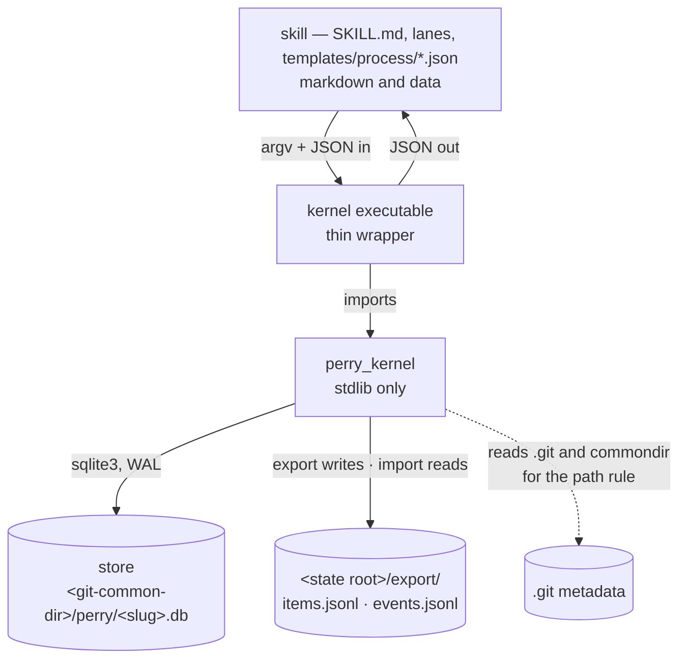
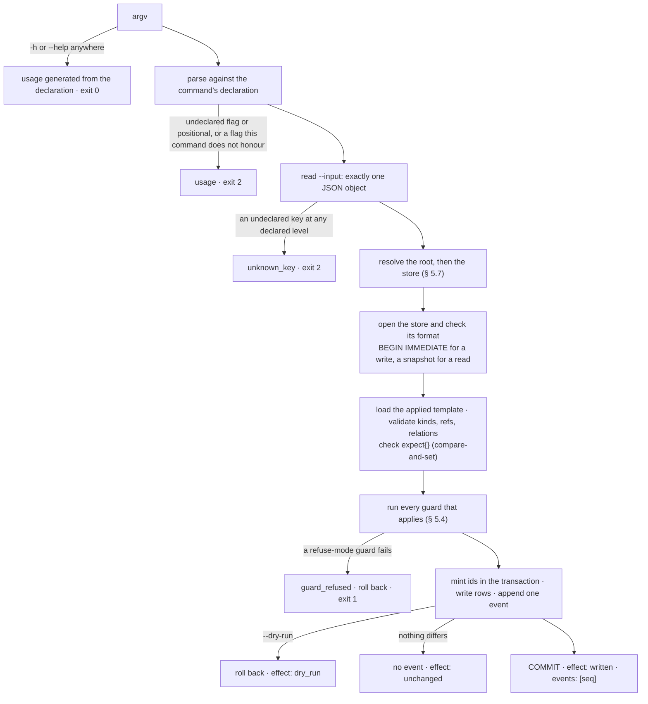

# Architecture — `kernel/`

> Written by: agent · Confirmed by: —
> Version: v1
> Last reviewed: 2026-09-24
> Module document for the `kernel/` component. [`ARCHITECTURE.md`](../ARCHITECTURE.md) § 2 names it; the user confirmed that entry on 2026-09-24 (merged in 34d7be63).
> Cap: ≤ 600 lines. This is the kernel's specification, written before any kernel code exists (DESIGN-023 § 6 row A). The design it specifies is `perry/design/DESIGN-023-a-kernel-and-a-skill.md`.

## §1. Mission & scope

The kernel holds a project's structured state and applies the structural rules that a
process template declares. It is stdlib-only Python behind one CLI, and every command takes
JSON and returns JSON. The skill (markdown) calls the kernel. The kernel never calls the
skill.

The kernel knows eight concepts (§ 2) and no method. Every item type, state, field,
transition and guard comes from the template, which is data that the skill ships. The names
in this document's examples (`widget`, `gauge`, `queued`, `bench`, `inspector`) are
invented and mean nothing to the kernel. DESIGN-023 Goal 1 applies to this document as it
does to the code.

It deliberately does **not** read, parse, lint or render markdown (Goal 2). It does not run
a command or spawn a process (decision 8), judge what a document means (decision 3), or
recommend a next step (decision 5). It does not serve several users, run a server, sync
machines or draw a UI (§ 3 Non-Goals). Status: built by DESIGN-023 § 6 row B; `bin/` stays
the live writer until each lane cuts over, and row C writes the first template.

## §2. Components

### The eight concepts (Goal 6)

| Concept | Fields |
|---|---|
| **Template** | `format` (the kernel's template-format version, `1`), `name`, `version` (a positive integer that only rises), `types{}`, `relations{}`. One version is applied at a time, and applying one is an event (§ 5.2) |
| **Item** | `id` (minted from its type's prefix), `type`, `state`, `fields{}` (every declared field, `null` when unset), `seq` (the seq of the last event that touched it), `created_at`, `updated_at` |
| **Field** | declared per type: `kind` is one of `text` `int` `number` `date` `enum` `actor` `ref` `list` `metric`, plus that kind's options (§ 5.3). Its value lives on the item |
| **Transition** | declared per type: `name`, `from` (one or more states), `to` (one state), `guards[]` |
| **Guard** | `kind` (`required` · `actor` · `relations_closed` · `limit`), the kind's keys, and an optional `when` (§ 5.4). Guards run on create and on transitions |
| **Relation** | `kind`, `from`, `to`. The built-in kinds are `blocks` (*from* blocks *to*) and `parent` (*to* is the parent of *from*). The template can declare others |
| **Event** | `seq`, `at`, `actor`, `command`, `items[]`, `transition`, `changes[]` (each with a `key` and its `before` and `after` values), `note`, `warnings[]`. Events are append-only and are the store's history (ADR-022) |
| **Attachment** | `item`, `ref` (a path or URL, kept verbatim), `hash` (optional, `sha256:<hex>`). The kernel never opens the target |

`startable`, `blocked_by`, a metric's `met` and `fraction`, and an item's `rollup` are
derived when read and never stored (§ 5.5, § 5.6).

### Layout (DESIGN-023 § 5.5)

`kernel/` holds the `perry_kernel` package, its tests and this file. The executable,
`bin/perry-kernel`, is a thin wrapper of a few lines that imports `perry_kernel` and calls its
`main()`; the user named it on 2026-09-24 (OQ-K6), and row H renames it `bin/perry`. The
package is cached as bytecode, so nothing is recompiled per call. This document writes `kernel`.

### The budget

**8 concepts** (the eight above) and **at most 12 command groups**. Ten groups are in use:
`init`, `template`, `item`, `rel`, `attach`, `query`, `events`, `export`, `import` and
`describe`. There are also **exactly 4 guard kinds and 9 field kinds**. A fifth guard kind
or a tenth field kind is a concept change (DESIGN-023 § 3, § 7).

**How a test checks it.** `describe` reports `concepts`, `budget`
(`{"concepts": 8, "command_groups": 12}`), every command, and the template format's
`field_kinds` and `guard_kinds`. The kernel suite asserts that `concepts` is exactly the
list above, that `commands[].name` has at most 12 distinct first words, that there are 4
guard kinds and 9 field kinds, and that `budget` equals the test's own literals, 8 and 12.
The test does not read this file, because the kernel suite must pass with every `*.md`
removed (Goal 2). Raising a number means editing both the test literal and this section,
and DESIGN-023 § 7 makes that a revision of the design, not a new row.

## §3. Boundaries & dependencies



Allowed directions: skill → kernel → store. There are no others.

Forbidden:
- **Importing anything outside the stdlib and `perry_kernel`**, `bin/`, `viewer/` and
  `release/` included. **Reading markdown**, in any mode (the suite runs with no `*.md`).
- **Running a command.** The kernel makes no `subprocess`, `os.system`, `os.exec*` or
  `os.spawn*` call. It finds the git common dir by reading `.git` and `commondir` (§ 5.7).
  The skill runs a measurement's command and writes the value (decision 8).
- **Naming a skill path or a template-declared name.** Goal 1's test greps the kernel
  source for every type, state and field name in the shipped template. It matches whole
  words, case-sensitively. A collision is fixed by renaming on the kernel's side.
- **Any other path.** The kernel reads only its store, its `--input` file, the `.git`
  metadata and the export. It writes only the store and `<state root>/export/`. Only
  `import` loads the export; `export` reads its own files only to tell `unchanged` apart.

## §4. Data flow — what happens to one command



One command is one transaction. A refusal after `BEGIN` rolls back the whole transaction,
including the relations and attachments written by the same `item create`, so an edge made
at create cannot half-land (DESIGN-015 § 5.3). An unexpected exception is caught at the
top, rolled back and reported as `internal`. No traceback reaches the caller (NN-K6).

## §5. Contracts

### 5.1 The envelope, exit codes and error codes

Every command writes exactly one JSON object to stdout, with or without `--json`, and that
object is the whole answer. Anything a program must act on, warnings included, is a field
in it. On a refusal, stderr also carries one line, `kernel: <code>: <message>`, which
repeats `error` for a human. Every key is always present.

```json
{"ok": true, "surface": "1.0", "command": "item move", "effect": "written",
 "events": [57], "store_seq": 57, "warnings": [], "result": {"item": {"…": "…"}},
 "error": null}
```

`effect` is `written` (at least one event committed, or export files replaced),
`unchanged` (a write that found nothing to change and wrote no event), `dry_run` (the
transaction ran and was rolled back), `read`, or `refused`. `events` lists the seq of each
event this command committed, and is empty unless `effect` is `written`. `store_seq` is the
highest event seq visible to the command, after its commit. Reads carry it too, so a poller
can tell a stale read from a fresh one. On a refusal, `ok` is `false`, `result` is `null`,
and `error` is `{"code", "message", "details"}`. Exit codes: `0` success · `1` refused ·
`2` bad invocation · `3` internal fault (rolled back).

| Code | Exit | When |
|---|---|---|
| `usage` | 2 | an unknown command, an undeclared flag or positional, a flag this command does not honour (`--dry-run` on a read), or a missing flag argument |
| `input_invalid` | 2 | `--input` is not exactly one JSON object, or a declared key has the wrong JSON type |
| `unknown_key` | 2 | the input carries a key the command does not declare, at any declared level. The legal set is named |
| `actor_invalid` | 2 | a write has no `actor`, the actor's `kind` is not `human` or `agent`, its `name` is empty, or an `agent` has no `session` |
| `anchor_not_found` | 1 | no directory holding `.perry/` at `--root`, at `PERRY_PROJECT`, or above the working directory |
| `store_missing` | 1 | the resolved store has not been initialised |
| `store_foreign` | 1 | the file at the store path is not a kernel store. It is never overwritten |
| `store_version` | 1 | the store's format is newer than this kernel |
| `store_busy` | 1 | the write lock was not acquired within 5 s |
| `store_corrupt` | 1 | `sqlite3` reports damage, or a row cannot be read back |
| `store_live_under_test` | 1 | `PERRY_KERNEL_TESTING` is set and the store path was derived, not named (§ 5.7) |
| `store_initialized` | 1 | `init` on a store initialised with a different state root |
| `store_not_empty` | 1 | `import` into a store that holds any event |
| `io_error` | 1 | a file the command must read or write could not be. The path is named |
| `no_template` | 1 | an item, relation, attachment or query command before any template is applied |
| `template_invalid` | 1 | the template breaks § 5.2. `details.problems[]` lists each as `{path, message}` |
| `template_version` | 1 | `version` is not above the applied one, or equals it with different content |
| `template_incompatible` | 1 | the new version would strand stored data (§ 5.2). The affected items are named |
| `item_not_found` | 1 | an id in the input, a `ref` value or a relation end does not exist |
| `unknown_type` · `unknown_field` · `unknown_transition` · `unknown_relation` | 1 | the applied template does not declare that name |
| `field_invalid` | 1 | a value does not fit its field's kind (§ 5.3) |
| `metric_invalid` | 1 | a metric value breaks § 5.5 |
| `transition_not_allowed` | 1 | the item's state is not in the transition's `from` |
| `guard_refused` | 1 | one or more refuse-mode guards failed. `details.guards[]` lists every one (§ 5.4) |
| `relation_invalid` | 1 | a self-edge, an end whose type the declaration does not allow, or a second `parent` |
| `relation_cycle` | 1 | a `blocks` or `parent` edge would close a cycle |
| `stale_write` | 1 | an item named in `expect` has moved: its `seq` is not the one the caller read |
| `attachment_invalid` | 1 | an empty `ref`, a `ref` containing a line break, or a malformed `hash` |
| `export_dir_foreign` | 1 | `<state root>/export/` holds an entry other than the kernel's two files |
| `export_missing` · `export_invalid` | 1 | `import` finds no export, or a line or a seq run that breaks § 5.8 |
| `replay_mismatch` | 1 | replaying the events does not reproduce `items.jsonl`. The first differing id is named |
| `internal` | 3 | an unexpected fault. The transaction was rolled back |

§ 5.6 cites three error sets. **A** is `usage`, `input_invalid`, `unknown_key` and
`internal`. **S** is A plus `anchor_not_found`, `store_missing`, `store_foreign`,
`store_version`, `store_busy`, `store_corrupt`, `store_live_under_test` and `io_error`.
**W** is S plus `actor_invalid`. The only warning code is
`limit_exceeded`.

### 5.2 The process template — format 1

```json
{"format": 1, "name": "workshop", "version": 3,
 "types": {
  "widget": {
   "prefix": "W", "digits": 3,
   "states": ["queued", "cutting", "polished", "shipped", "scrapped"],
   "initial": "queued", "terminal": ["shipped", "scrapped"],
   "fields": {
    "size":      {"kind": "enum", "values": ["XS", "S", "M", "L"], "ordered": true},
    "bench":     {"kind": "enum", "values": ["north", "south"]},
    "fragile":   {"kind": "enum", "values": [false, true]},
    "inspector": {"kind": "actor"},
    "ship_by":   {"kind": "date"},
    "made_from": {"kind": "ref", "to": ["widget"]},
    "colors":    {"kind": "list", "of": {"kind": "text"}},
    "weight_g":  {"kind": "number"}},
   "create_guards": [{"kind": "required", "fields": ["bench"]}],
   "transitions": {
    "start":  {"from": ["queued"], "to": "cutting", "guards": [
      {"kind": "relations_closed", "relation": "blocks", "direction": "incoming"},
      {"kind": "limit", "max": 2, "per": ["bench"], "mode": "warn"}]},
    "polish": {"from": ["cutting"], "to": "polished", "guards": []},
    "ship":   {"from": ["polished"], "to": "shipped", "guards": [
      {"kind": "required", "fields": ["inspector"], "at_least": {"size": "S"}},
      {"kind": "actor", "actor_kind": "human", "when": {"fragile": [true]}},
      {"kind": "relations_closed", "relation": "parent", "direction": "incoming"}]},
    "scrap":  {"from": ["queued", "cutting", "polished"], "to": "scrapped", "guards": []}}},
  "gauge": {
   "prefix": "G", "states": ["live", "retired"], "initial": "live", "terminal": ["retired"],
   "fields": {"reading": {"kind": "metric"}},
   "transitions": {"retire": {"from": ["live"], "to": "retired", "guards": []}}}},
 "relations": {"pairs_with": {"from": ["widget"], "to": ["widget"]}}}
```

| Rule | |
|---|---|
| Keys | Only the keys shown are legal, at every level. `digits` (default 1) and `create_guards` (default `[]`) may be left out. An unknown key is `template_invalid` |
| Names | Types, fields, states, transitions and relation kinds match `^[a-z][a-z0-9_]{0,39}$`. `id`, `type` and `state` cannot be field names. `blocks` and `parent` cannot be declared |
| Prefixes | match `^[A-Z][A-Z0-9]{0,9}$` and are unique across types. An id is `<prefix>-<n>`, where `n` is zero-padded to `digits` and grows past it (`W-999`, `W-1000`) |
| States | `initial` ∈ `states`. `terminal` is a non-empty subset of `states`. Every transition's `from` ⊆ `states`, and its `to` ∈ `states` |
| Relations | A declared kind lists the types allowed at its `from` and `to` ends. `blocks` and `parent` connect items of any types |
| Guards | § 5.4. Every field a guard names must be declared on the guard's type |
| Apply | `version` must rise. Re-applying the identical template is `unchanged`. Guards govern writes, not stored state, so existing items are not re-checked |
| Compatibility | A new version is `template_incompatible` while stored data depends on what it drops. It cannot remove a type that has items, a state that items occupy, a field that holds a value, an enum value in use, a `ref` target type in use, or a relation kind that has edges. It cannot change the kind of a field that holds a value, or the `prefix` or `digits` of a type that has items. Adding is always compatible (Goal 4) |

### 5.3 Field kinds and their values

| Kind | Options | Value | Set when |
|---|---|---|---|
| `text` | — | a JSON string | non-empty after trimming whitespace |
| `int` | — | a JSON integer (not a boolean), with \|n\| ≤ 2⁵³ | not `null` |
| `number` | — | a finite JSON number | not `null` |
| `date` | — | a valid calendar date, `YYYY-MM-DD` | not `null` |
| `enum` | `values` (strings or booleans, unique), `ordered` (default `false`) | one of `values` | not `null` |
| `actor` | — | `{"kind": "human" \| "agent", "name", "session"}`, with `session` required for `agent` | not `null` |
| `ref` | `to` (type names) | the id of an existing item of one of those types | not `null` |
| `list` | `of`: one element declaration of any kind except `list` and `metric` | a JSON array of such values | non-empty |
| `metric` | — | `{"current", "target", "baseline", "direction"}` (§ 5.5) | `current` is not `null` |

There is no boolean kind. A flag is an `enum` with `values: [false, true]`, as in
`when: {"fragile": [true]}` (decision 9). `set` replaces a field's value whole, except for a
`metric`: the keys given are merged into the stored value, so a measurement can write
`{"current": 8}` alone. The first `set` of a metric must carry `target` and `direction`.

### 5.4 Guards

| Kind | Keys | Refuses unless |
|---|---|---|
| `required` | `fields[]`, `at_least{}` (at least one is non-empty) | every listed field is set (§ 5.3), and every `at_least` field is an ordered enum whose value is set and sits at or after the named minimum in `values` |
| `actor` | `actor_kind` and/or `name` | the command's actor has that `kind` and/or exactly that `name`. The actor is caller-declared, so this names a person but does not authenticate one (DESIGN-023 § 5.2) |
| `relations_closed` | `relation`, `direction` (`incoming` or `outgoing`) | every item at the other end of an edge of that kind is in a terminal state. `incoming` means edges whose `to` is this item, such as a `blocks` edge's blockers or a `parent` edge's children. `outgoing` means edges whose `from` is this item |
| `limit` | `max` (an integer ≥ 1), `per[]` (field names, possibly none), `mode` (`refuse` or `warn`) | counting this item, no more than `max` items of its type would sit in the target state with the same values of the `per` fields. `warn` proceeds and reports `limit_exceeded` |

- **`when`.** Any guard may carry one `when`: exactly one field of the item, mapped to a
  list of values, where `null` matches unset. The guard applies only when the item's value
  is in that list. Neither `when` nor `per` may name a `list` or a `metric` field.
- **When and on what.** A type's `create_guards` run on `item create`, with `initial` as
  the target state, and a transition's `guards` run on `item move`. Guards see the item as
  the command would leave it, including fields and relations set by the same command.
- **Reporting.** Every guard is evaluated. When any refuse-mode guard fails,
  `details.guards[]` lists each failure as `{"index", "kind", "when", "detail"}`:
  - `required`: `{"missing": [...], "below": {"size": {"value": "XS", "at_least": "S"}}}`;
  - `actor`: `{"actor": {...}, "needs": {...}}`; `relations_closed`: `{"not_terminal": ["W-3"]}`;
  - `limit`: `{"count": 3, "max": 2, "values": {"bench": "north"}}`.

  When a warn-mode `limit` fails and nothing refuses, the command succeeds and the failure
  lands in `warnings[]` and on the event.

### 5.5 Metrics: the formula and the roll-up

This section is derived from DESIGN-022 § 5.1 and § 5.2. The rule is fixed, and no template
key changes it.

A metric value is `{"current": number|null, "target": number, "baseline": number|null,
"direction": "up"|"down"}`. It is `metric_invalid` when `target` or `direction` is
missing, a key is unknown, a number is not finite, or `baseline` is set and `target` is not
beyond it in `direction` (above it for `up`, below it for `down`).

DESIGN-022's five directions map onto these two without loss, because the baseline is what
tells a trend from a limit:

| DESIGN-022 | Here |
|---|---|
| `increase` · `decrease` | `up` · `down`, with a `baseline` |
| `at_least` · `at_most` | `up` · `down`, with `baseline: null` |
| the milestone direction | `up`, `target: 1`, `baseline: null`, `current` 0 or 1 |

```
met       null when current is null · up: current >= target · down: current <= target
fraction  null when current or baseline is null; otherwise
          raw = (current - baseline) / (target - baseline)
          0.0 if raw <= 0 · 1.0 if raw >= 1 · else round(raw, 3) clamped to [0.001, 0.999]
          (0.0 and 1.0 are reserved for the exact ends, as DESIGN-022 publishes them)
```

`item get` and `query` return `met` and `fraction` inside the metric's value. Neither is
stored or exported. The kernel never runs a command. The skill runs a measurement's
declared command, then writes `current` with `item update` and passes the command in
`note`. The event records it, so DESIGN-022's rule that only a command measures still holds.

**The roll-up.** DESIGN-022 User Decision 2 folds several measured conditions into one
answer. An item's `rollup` folds the metric fields of the items whose `parent` it is, one
level down, whatever their state (OQ-K1, option (a), answered by the user on 2026-09-24).
Every metric field declared on a child's type is one member, and an unset one is
unmeasured; the item's own metric fields are not members, and no template key changes any
of this. `rollup` is `null` when no child's type declares a metric field, and otherwise
`{"members", "measured", "met", "fraction"}`. `measured` counts members with a `current`.
`met` is `null` when any member is unmeasured, `true` when every member is met, and `false`
otherwise. `fraction` is the single member's `fraction` when there is exactly one member,
and `null` otherwise. It is never a mean.

### 5.6 Commands

**Flags.** `--store PATH` and `--root PATH` (§ 5.7), `--json`, and `-h` / `--help` apply to
every command. `--input JSON|@FILE|-` (inline JSON, a file, or stdin) is taken only where a
command has input, and `--dry-run` only on writes.

**Common write keys.** A write that appends its own event (every write but `export` and
`import`) takes `actor` (required, § 5.3) and `note` (optional text, stored on the event).
The item, `rel` and `attach` writes also take `expect` (optional, `{"<id>": <seq>}`), which
is compare-and-set: each named item's `seq` must still be the one the caller read, or the
write is refused as `stale_write`.

**Items in `result`.** An item carries the § 2 keys plus `relations[]` (every edge touching
it, as `{kind, from, to}`), `attachments[]`, `startable`, `blocked_by` and `rollup`.
`blocked_by` lists, sorted, the non-terminal items that have a `blocks` edge to this item.
`startable` is true when the item is in its type's `initial` state and `blocked_by` is
empty.

| Command | Input | `result` | Errors |
|---|---|---|---|
| `init` | `actor`, `state_root` (a relative path inside the anchor) | `store`, `anchor`, `state_root`, `journal_mode` | A, `anchor_not_found`, `store_foreign`, `store_version`, `store_busy`, `store_corrupt`, `store_live_under_test`, `io_error`, `actor_invalid`, `store_initialized` |
| `template apply` | `actor`, `template`, `note` | `name`, `version`, `previous_version` | W, `template_invalid`, `template_version`, `template_incompatible` |
| `template show` | — | `template` (the applied one, verbatim), `version`, `applied_seq`, `applied_at`. All four are `null` before the first apply | S |
| `template validate` | `template` | `valid: true`, `format`, `types` (a count). It checks the format only and opens no store. `template apply --dry-run` tests compatibility | A, `io_error`, `template_invalid` |
| `item create` | `actor`, `type`, `fields{}`, `relations[]` (`{kind, to}` or `{kind, from}`, where the new item is the other end), `attachments[]` (`{ref, hash?}`), `note`, `expect` | `item` | W, `stale_write`, `no_template`, `unknown_type`, `unknown_field`, `field_invalid`, `metric_invalid`, `item_not_found`, `unknown_relation`, `relation_invalid`, `relation_cycle`, `attachment_invalid`, `guard_refused` |
| `item get` | `id` | `item` | S, `no_template`, `item_not_found` |
| `item update` | `actor`, `id`, `set{}`, `unset[]`, `note`, `expect`. No guards run | `item` | W, `stale_write`, `no_template`, `item_not_found`, `unknown_field`, `field_invalid`, `metric_invalid` |
| `item move` | `actor`, `id`, `transition`, `set{}`, `unset[]`, `note`, `expect` | `item`, `transition`, `from_state`, `to_state` | W, `stale_write`, `no_template`, `item_not_found`, `unknown_transition`, `transition_not_allowed`, `unknown_field`, `field_invalid`, `metric_invalid`, `guard_refused` |
| `rel add` · `rel remove` | `actor`, `kind`, `from`, `to`, `note`, `expect`. Adding an existing edge, or removing a missing one, is `unchanged` | `relation` | W, `stale_write`, `no_template`, `item_not_found`, `unknown_relation`, `relation_invalid`, `relation_cycle` (on add) |
| `attach add` · `attach remove` | `actor`, `id`, `ref`, `hash` (on add), `note`, `expect` | `attachment` | W, `stale_write`, `no_template`, `item_not_found`, `attachment_invalid` |
| `query` | `type`, `ids[]`, `state[]`, `terminal`, `where{field: [values]}`, `related` (`{kind, to}` or `{kind, from}`), `startable`, `count_by[]`, `after`, `limit` | `items[]`, `total`, `returned`, `truncated`, `next_after`, `counts[]` | S, `no_template`, `unknown_type`, `unknown_field`, `unknown_relation`, `item_not_found` |
| `events` | `items[]`, `keys[]` (key prefixes), `commands[]`, `after_seq`, `limit` | `events[]`, `total`, `returned`, `truncated`, `next_after_seq`, `last_export_seq`, `unexported` | S |
| `export` | — | `dir`, `files{name: {lines, bytes, sha256}}`, `last_export_seq`. It is `unchanged` when both files already hold these bytes | S, `export_dir_foreign` |
| `import` | `state_root` | `dir`, `items`, `events`, `last_seq`, `verified: true` | A, `anchor_not_found`, `store_foreign`, `store_version`, `store_busy`, `store_corrupt`, `store_live_under_test`, `io_error`, `store_not_empty`, `export_missing`, `export_invalid`, `replay_mismatch` |
| `describe` | — (no `--input`, and no store is opened) | `surface`, `concepts`, `budget`, `commands[]`, `flags`, `env`, `exit_codes`, `errors`, `template_format` | A |

**Reads.** In `query`, separate filters are ANDed and the values within one filter are
ORed. There is no expression language. A `where` or `count_by` that names a field needs
`type`. `counts[]` is `[{"key": {...}, "n": N}]`, counted over every match before the
bound, and `count_by` takes `type`, `state` or any field that is not a `list` or `metric`.
Items are ordered by prefix, then number, and `after` continues from an id. `query` and
`events` return at most 50 rows unless `limit` says otherwise (`limit: 0` asks for
everything), and `total` and `truncated` are always present.

**`describe`** reports the command surface only, so it is byte-identical in every project:
it never reads a store, a path or a clock.
- Each entry of `commands[]` carries `name`, `kind` (`read` or `write`), its flags, its
  input keys with JSON types and `required` markers, its `result` keys and its error codes.
- `template_format` carries `format`, `field_kinds`, `guard_kinds`, the built-in relations
  and the template's key schema.
- `surface` is versioned under DESIGN-005's rules (decision 11). Every key is always
  present, and a minor version only adds, which includes adding an optional input.
  **Making an input required, or removing one, is a major change, and a major bump is
  refused without the user.**
- `describe` and `template show` are the only places the skill learns the data model
  (DESIGN-023 § 5.1).

**Events.** A change `key` is `type`, `state`, `field:<name>`, `rel:<kind>:<from>:<to>`
(value `false`/`true`), `attach:<ref>` (value `null`/`{"hash"}`), `template` (`before` is
the previous version and `after` the full template), `state_root` (written by `init`) or
`ceiling:<prefix>`. `items[]` names every item the event touched, and each one's `seq`
becomes the event's seq.

### 5.7 The store

- **The anchor** is `--root`, else `PERRY_PROJECT`, else the first directory at or above
  the working directory that holds `.perry/`; it must hold `.perry/` (`anchor_not_found`).
  ADR-002 still holds: a project is a folder with a `.perry/` anchor, and nothing lists
  projects. **The path** is `--store`, else `PERRY_STORE`, else `<common>/perry/<slug>.db`
  inside git and `<anchor>/.perry/perry.db` outside it.
- **`<common>`** is what `git rev-parse --git-common-dir` prints, read instead of run. The
  kernel walks up from the anchor to `.git` and, if `.git` is a file, follows its `gitdir:`
  line. If that git dir holds `commondir`, the common dir is that path resolved against
  the git dir; otherwise it is the git dir. `GIT_DIR` and `GIT_COMMON_DIR` are ignored. A
  test compares the result with `git rev-parse` on a main worktree, a linked worktree and
  a submodule.
- **`<slug>`** is `root` for a worktree's top level. For any other anchor it is
  `root/<path from the top level>`, with every byte outside `[A-Za-z0-9._-]` (including
  `/`) written as `%XX`. For example, `tests/fixtures/alpha` becomes
  `root%2Ftests%2Ffixtures%2Falpha`. The slug is injective. Every worktree resolves the
  same file, and each fixture project gets its own (DESIGN-023 § 5.3).
- **Opening.** `init` creates the parent directory and the file and sets
  `journal_mode=WAL`. Opening a store checks WAL, `synchronous=FULL` and the format marker
  (`PRAGMA application_id` and `user_version`). A foreign file is refused.
- **Transactions.** A write is one `BEGIN IMMEDIATE` transaction with a 5 s busy timeout
  (`store_busy`), so the lock spans the read, the decision and the write. A read is one
  snapshot. Under WAL, a reader in one worktree sees another worktree's commit at once
  (Goal 5).
- **Ids.** The store keeps a ceiling per prefix. An id is minted inside the write
  transaction as `ceiling + 1`, so two writers cannot mint the same id. A ceiling is never
  lowered, an id is never reused, and no command deletes an item. A `ceiling:<prefix>`
  event raises a ceiling above the stored ids. No command writes one: it arrives only by
  `import`, in an export that DESIGN-023 § 6 row D's importer builds to seed ids that were
  issued and later purged (§ 5.8). `--dry-run` reports the id it would mint unreserved.
- **Tables.** `meta` (format, `state_root`, `last_export_seq`), `template`, `item`,
  `value`, `relation`, `attachment`, `event` and `ceiling`. Row B owns the columns.
- **The live-store check, which tests rely on,** has two layers:
  - **Prevention.** Kernel tests, and fresh-context reviewers who corrupt a store on
    purpose, always pass `--store <tmp>`. The harness sets `PERRY_KERNEL_TESTING=1`, under
    which a derived path is refused (`store_live_under_test`), so a call that forgets
    `--store` fails instead of writing the shared store.
  - **Detection.** The harness reads the live store's highest event seq read-only before
    and after the run. A new event whose actor carries the run's own session fails the
    suite; one from any other session is reported, not failed (OQ-K4). This is the
    kernel's `tests/tree_guard.py`, which cannot see inside `.git/` (DESIGN-023 § 5.3).

### 5.8 Export and import

- **`export`** writes exactly two files, `<anchor>/<state_root>/export/items.jsonl` and
  `events.jsonl`, and then records `last_export_seq`. It refuses (`export_dir_foreign`) if
  the directory holds any other entry. Each file is written to a temporary name and
  renamed into place.
- **The bytes are deterministic.** Each line is one JSON object with sorted keys, `,` and
  `:` separators, UTF-8 without ASCII escaping and a `\n` ending, and numbers are written
  as stored. `items.jsonl` is sorted by prefix, then number, one
  `{id, type, state, fields, relations, attachments, created_at, updated_at, seq}` per line,
  with only outgoing edges (`{kind, to}`) and no derived key. `events.jsonl` is sorted by
  `seq`. Two exports of an unchanged store are byte-identical.
- **`import`** needs an empty store: the file is absent or holds no event
  (`store_not_empty`). In one transaction it:
  1. reads `<anchor>/<state_root>/export/`, and checks that the seqs run 1…n without a gap
     and that event 1 is the `init` for this `state_root` (`export_invalid`);
  2. replays every change by seq, checking that each `before` equals the replayed value,
     without re-running guards, because the history was written under earlier templates;
  3. sets each ceiling to the higher of the largest id replayed and the largest
     `ceiling:<prefix>` value;
  4. serialises the replayed items as `export` would and compares them byte for byte with
     `items.jsonl` (`replay_mismatch`).

  `import` writes no event of its own, so export, import and a second export are
  byte-identical (Goal 3).
- **Only `import` loads the export;** `export` reads it only to decide `unchanged`. Committing it is the user's choice (DESIGN-023
  § 5.3). `events` reports `unexported`, the events written since the last export (OQ-K3).

### 5.9 The argument for each new claimed path (ADR-016)

**`<git-common-dir>/perry/<slug>.db`**
- **Why this path, and not a claim Perry already holds.** The existing claims, the state
  root and `.perry/`, sit in the worktree and follow the branch, so a store there gives
  every checkout its own copy and lock. That is how two checkouts minted the same id while
  `git merge` saw two lines of text, not one contested identity (DESIGN-023 § 1, item 3).
  The git common dir is the one place every worktree of a repository resolves to, and git
  keeps nothing under `perry/` there. Outside git, `<anchor>/.perry/perry.db` is a new
  file inside the existing `.perry/` claim, not a new claimed path.
- **The cost to a project that has a file of that name.** A foreign file is refused
  (`store_foreign`) and never overwritten. The directory is invisible to `git status` and
  lost on a fresh clone, which is why the export exists and `events` reports what is
  unexported (DESIGN-023 § 7). **Reversal:** `export`, remove the directory, `import`.

**`<state root>/export/`**
- **Why this path.** The export is the backup and the surface for reading changes, so it
  must sit in the worktree where it can be committed. The state root is already Perry's
  claim (DESIGN-002), so this is a subdirectory of an existing claim, not a new top-level
  name. It is not under `.perry/`, because committing it is the project's choice.
- **The cost to a project that has a file of that name.** A project's own `export/` under
  its state root is kept: `export` refuses while any other entry is there
  (`export_dir_foreign`). **Reversal:** delete the directory; only `import` loads it.

Neither path is added to the current claims register, `schema/state-schema.json`: that is
a schema change outside this row, and the file is deleted at row H.

## §6. Non-negotiables

Every rule below is **proposed** (NN-6), and none of them binds until the user confirms it.
NN-K3 to NN-K8 restate DESIGN-016's argument-contract lessons as rules of this CLI.

### NN-K1 — The kernel knows no method
- **Severity**: hard · **Status**: proposed
- **Rule**: kernel source names no skill path, and no type, state or field that the
  shipped template declares (Goal 1).
- **Check**: the grep test in § 3, and the kernel suite run with every `*.md` removed.

### NN-K2 — The kernel runs no command and reads no markdown
- **Severity**: hard · **Status**: proposed
- **Rule**: no process is spawned, whether for a metric or for the git path rule. No
  markdown file is opened.
- **Check**: a source scan for the process calls listed in § 3, and the markdown-free run.

### NN-K3 — `--help` never executes
- **Severity**: hard · **Status**: proposed
- **Rule**: `-h` or `--help`, in any argument position, prints the generated usage and
  exits 0, before the root or store is resolved, `--input` is read, or any lock is taken.
- **Rationale**: DESIGN-016 goal 2. A `bin/` render once ran when it was asked for help.

### NN-K4 — Nothing undeclared is accepted
- **Severity**: hard · **Status**: proposed
- **Rule**: every command, read-only ones included, refuses with exit 2 an undeclared flag
  or positional, a flag it does not honour (`--dry-run` on a read, `--input` on
  `describe`), and an undeclared input key at any level. An undeclared template key is
  `template_invalid`, and an undeclared export key is `export_invalid`. Nothing is
  accepted and then ignored.
- **Rationale**: DESIGN-016 § 1.4 and goal 12. `--wrte` printed a render, wrote nothing,
  and exited 0.

### NN-K5 — An explicit flag beats the environment
- **Severity**: hard · **Status**: proposed
- **Rule**: `--root` beats `PERRY_PROJECT`, which beats the walk up. `--store` beats
  `PERRY_STORE`, which beats the derived path (§ 5.7).
- **Rationale**: DESIGN-016 goal 1. A write landed in a project the caller never named.

### NN-K6 — No traceback, and stdout is the whole answer
- **Severity**: hard · **Status**: proposed
- **Rule**: every outcome, an internal fault included, reaches the caller as one JSON
  envelope on stdout and an exit code. A refusal adds one stderr line. An advisory that a
  program must act on is an envelope field, never only a stderr line.
- **Rationale**: DESIGN-016 § 1.5 and goal 10. A refusal once escaped as a traceback.

### NN-K7 — Reads are bounded by default
- **Severity**: hard · **Status**: proposed
- **Rule**: `query` and `events` return at most 50 rows unless `limit` says otherwise, and
  always report `total` and `truncated` (DESIGN-016 goal 6).

### NN-K8 — A no-op reads differently from a write
- **Severity**: hard · **Status**: proposed
- **Rule**: `effect` says `written`, `unchanged` or `dry_run`. A write that changes nothing
  appends no event and says so, and every write returns its seqs and `store_seq`.
- **Rationale**: DESIGN-016 § 1.5. A render exited 0 having restored none of 151 rows.

### NN-K9 — Tests never touch the live store
- **Severity**: hard · **Status**: proposed
- **Rule**: kernel tests name a temporary store, and § 5.7's live-store check fails the
  suite otherwise. This is root NN-5's reason, moved inside `.git/`.

### NN-K10 — Ids are minted in the transaction, and a ceiling never falls
- **Severity**: hard · **Status**: proposed
- **Rule**: an id is minted inside the write transaction, and no command lowers a ceiling
  or reuses an id. Two checkouts once minted the same id (DESIGN-023 § 1), and Goal 5's
  concurrent-worktree test holds this rule.

## §7. Open questions

- **OQ-K1 — Which metric values fold together? Resolved: the user chose (a) on
  2026-09-24, and § 5.5 now defines `rollup`.** DESIGN-022 fixes the fold (§ 5.5). It does not say which values fold together once the
  measured things are items of their own (DESIGN-023 § 5.4). The options:
  - (a) **The `parent` children.** An item's `rollup` folds every metric field of the
    items whose `parent` it is. It needs no template key and fits § 5.4's separate types;
    an item with no metric-bearing children gets `null`.
  - (b) **A marked relation.** One declared relation kind per template carries
    `"fold": true`. The rule stays fixed; the relation it follows is data.
  - (c) **Several metrics on one item**, as a `list` of `metric`. This contradicts § 5.4,
    and list elements have no ids to update one at a time.
  - (d) **No fold in the kernel.** The skill folds `query` output, against decision 8
    ("fixes how several … roll up") and root § 3 (a lane does not compute a number).

  Two further questions follow from the answer and stay open: a second-level count, like
  DESIGN-022 § 5.2's per-grouping counts that exclude items by a field, and whether
  `count_by` may count by `rollup.met`.
- **OQ-K2 — The age of a measurement.** DESIGN-022's `due` state needs the time at which
  `current` last changed. Either (a) the skill reads it from `events`
  (`keys: ["field:<name>"]`) and applies its own threshold, which works today, or (b) the
  metric output gains a derived `current_at`, a key decision 8 does not name.
- **OQ-K3 — Where the count of unexported events lives.** DESIGN-023 § 5.3 has `describe`
  report it, and § 5.1 makes `describe` byte-identical across projects; both cannot hold.
  This document keeps § 5.1 and puts the count on `events` (`unexported`), a departure
  from § 5.3 that needs a DESIGN-023 `## Changes` entry.
- **OQ-K4 — Detection versus another session's write. Resolved: the user answered on 2026-09-24 — an event of the run's own session fails the suite, another session's is reported — and `kernel/tests/livestore.py` implements it.** The store is shared. If another
  worktree writes during a test run, detection sees a leak and the run goes red. Prevention
  is exact. Whether detection should report the new events or fail the suite is open.
- **OQ-K5 — Readings where DESIGN-023 is silent.** Each can be reversed. `limit.per` is a
  list, so decision 9's "a named field" can mean more than one. A metric is set once
  `current` is non-null. A flag is an `enum` of `[false, true]`. The slug is
  `root/<path>`, percent-encoded. The state root is recorded at `init`, so the kernel never
  reads `.perry/config.jsonl` (DESIGN-023 § 8). `startable` means the `initial` state with
  an empty `blocked_by`. An `agent` actor must carry `session`. `--json` is accepted
  everywhere and changes nothing, because output is always JSON; refusing it would be
  NN-K4's stricter reading.
- **OQ-K6 — The executable's name. Closed:** the user named it `bin/perry-kernel` on 2026-09-24 (§ 2).

## §8. Change log

- 2026-09-24/25 · v1 · TASK-487: § 2 lists `rollup` among the derived fields, line 6 records the confirmed § 2 entry, and the executable is `bin/perry-kernel` (OQ-K6 closed). Round 2: § 1 says the kernel is built, and § 7 marks OQ-K4 resolved. Round 3: § 3, § 5.8 and § 5.9 say `export` also reads the export, to decide `unchanged`; § 5.7 says detection fails only on the run's own session.
- 2026-09-24 · v1 · The user answered OQ-K1 with option (a): § 5.5 defines `rollup` over the
  `parent` children, and § 7 marks the question resolved.
- 2026-09-24 · v1 · Written for DESIGN-023 § 6 row A, before any kernel code exists. It
  covers the concepts, template format 1, every command with its input, output and error
  codes, the metric formula and fold, the store, export and import, the claims' arguments,
  and the CLI rules, proposed as NN-K1 to NN-K10. It includes eight CLI rules that the
  coordinator added with the user's approval the same day: write seqs and `store_seq`,
  `expect` with `stale_write`, `session` on the actor, required inputs in the versioned
  `describe`, stdout as the whole answer, the thin wrapper, and refusal of both undeclared
  positionals and flags a command does not honour.
