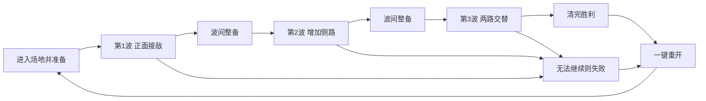

# 第一里程碑 M1：单场地三波战斗 v0.4

| 字段 | 内容 |
| --- | --- |
| 文档ID | design.prototype-scope |
| 类型／负责人 | 规则／策划（原作者与确认依据保留在正文） |
| 用途／读者 | 长期专业资料／策划、程序、美术 |
| 维护方式 | 持续维护 |
| 生命周期／修订／更新 | 当前／1.2（治理格式；原设计修订见正文）／2026-10-22 |
| 适用范围 | 当前M1设计输入／纸面核对，实际运行另验 |
| 依据／关联 | [领域入口](README.md)；原来源／任务见正文，治理CS-054 |

更新：2026-10-20。维护：策划。关联CS-004／010／027～029、CS-022。**用户已确认将第一里程碑简化为“在一个完整的场地里面完成击退几波敌人即可”。**本文为当前M1范围源头，优先于旧“任务→Perk→支援→撤离”首版要求，决定见[ADR-013](../decisions/ADR-013-first-milestone-wave-defense.md)。三波、数量、时长与波间规则是策划推荐默认；本轮统一规则作为下一批交接输入，未获逐项确认。程序已交[CBD v005候选](../tech/m1-cbd-integration.md)，本轮规则矩阵／玩法仍待整体验收，见[修正交接](../production/m1-rule-fixes-handoff.md)。

## 1 唯一目标

玩家进入一张连续、可游玩的城市战斗场地，用射击、移动和合作救援击退数波敌人；最后一波清完直接胜利，全队无法继续则失败，可立即重开。重点检验“枪好不好打、敌人好不好认和躲、这个场地打起来是否有趣”。不通过任务流程堆叠内容。

## 2 保留与延后

| 内容 | M1要求 | 后续里程碑 |
| --- | --- | --- |
| 场地 | 一张连续城市场地，地面／遮挡／边界／敌人通路和出生点可用 | 全上海街区任务布局、多个场景、路线随机 |
| 玩家武器 | 沿用锋刃步枪／铁砧机枪，可同角色重复；已有可用表现优先复用 | 六角色完整攻击、最终副武器、配件与新技能 |
| 操作 | 移动、转镜头、射击、换弹、跑跳与既有火箭靴 | 全套散布／ADS／后坐细则逐项接入，不作为全部齐备的前置条件 |
| 敌人 | 一种可读的近战小兵，优先对应A钳牙兵；有追击、举钳预警、攻击／恢复与死亡 | C炮兽、E卫兽及其他兵种、Boss |
| 流程 | 有限三波、清波、波间整备、胜负、重开 | 主目标、终端、转点、撤离、登机 |
| 成长和支援 | 固定基础武器与机动，不需成长或手动补给流程 | 全部Perk、信标代码、空袭、东方明珠激光 |
| 合作 | 既有1～4人LAN、倒地救援与默认关闭友伤；同角色可重复 | 新合作技能或强制职业搭配 |
| 建筑 | 已有静态遮挡、通路可用；现成破坏可保留，但不依赖破坏完成关卡 | 单楼／大范围破坏专项不阻塞M1 |
| 表现 | 能辨认角色、敌人、枪击、危险与任务边界；已有资产按实际接入状态使用 | 不要求全套正式资产、完整动作库或新付费素材 |

Godot、Windows＋macOS、键鼠／手柄、无分屏、房主权威和加入／重连的既有决定保留。复用现有网络框架，不为M1另造联机系统或扩大公网范围。既有授权、代码、资产和旧包不删除，延期的是本里程碑交付要求。

## 3 一个完整场地指什么

**最新用户选择：三塔CBD。**具体锚点、活动域、P／K1～K3／R、3门与三波准入时序按[CBD战场](m1-cbd-battlefield.md)，交付按[交接单](../production/m1-cbd-handoff.md)。[ADR-016](../decisions/ADR-016-m1-cbd-battlefield.md)记录区域选择；点位与数值待实际GLB／导航／试玩评审。程序已交v005同版CBD候选；中心绿地200米区仍保留测试。候选接入不等于空间偏差、路径／难度和真人验收全部完成。

2026-10-20更新：用户明确用正在制作的陆家嘴承载M1；美术已按用户认可的约2.4×2.0公里方向交2399×2004米母版，旧500米不再作为这张图的统一尺度，见[ADR-015](../decisions/ADR-015-lujiazui-map-and-combat-area.md)。城市远景＋独立任务边界原则保留。M1建议选C区CBD一个约100～140米连续街块，不要求跑遍全图；具体活动域贴合现有路网，并由美术程序同版检查。详见[地图总表与重玩方向](maps.md)。

“完整”要求：可通行地面闭合、边界清楚；有一处主要开阔交火区、少量建筑／街具形成侧路和遮挡；至少两个合法入场通路；玩家能绕行与救人；出生不在墙内、镜头不被遮挡卡死。远景能说明城市身份即可。不能用孤立60米沙盒、200米机制测试场或漂亮鸟瞰替代主场地验收，也不把完整场地解释为全城正式美术完成。

单个场地内变换来向就能变化战斗，不要求新增机关、可达楼顶、护送物或互动终端。不可进入建筑，已有城市远景与边界处理沿用。

## 4 三波默认编排

当前细表唯一源头为[CBD战场§4](m1-cbd-battlefield.md)：单人12／18／24只，上限4／6／8；第1波北门，第2波北门＋延迟西门，第3波北门＋延迟南门；各波人数缩放、请求时序、实际到达、合法刷点与延后规则在该文维护，不保留第二份不同的门点表。

一次请求不等于立即生成或接敌；必须验证位置、提前预警和连续路径。M1只要求有限近战小兵，不把大场景视野外自动遭遇或新巡航能力并入当前波次。卡死不得靠玩家全城找怪或无预告传送遮掩。

## 5 波间、资源与失败

波间建议15秒，无新进攻；非最终波清波只发一次整备奖励：恢复生命、补满常驻弹匣、让倒地／观战者回到合法出生点；常驻无限总备弹，不发有限备用包，不恢复本局自救次数。不需要补给箱、方向输入、Perk界面或全队读卡；时间到自动开始下一波。最终波后直接结算，不再整备或等待撤离。

主武器按[武器§9](weapons.md#9-m1武器采用边界)采用无限备弹，但弹匣照扣、仍需换弹；不加波内自动回血或无限弹匣。空匣频繁影响参与时先查换弹提示与间隔，不用增加总备用解决。单人自救默认启用、每局一次，候选5秒；波间复活、补满与重连都不重置消耗，曾合作的本局不因只剩一人重新启用。只有新局才重置本局资格；不新增复活道具。

推荐采用所有波次“同一权威步清波优先”：该步合法伤害／救援／到期事件处理后，待刷=0且存活=0时，前两波进入一次整备并返场，最终波直接胜利；都不返还已用自救。未清波且仍有行动者，继续并允许救援；无人行动但有合法自救，停刷等待；无合法自救时进入既有2秒失败宽限，宽限结束仍未清波／无人行动则失败。宽限终点同一步清波仍优先；一旦胜负提交，后到事件不能反转或重复奖励。房主退出单独结束本局，不算战败。

加入／重连保留当前波、待出兵量、存活敌人、身份、生命／倒地、弹匣、自救消耗、曾合作标志与冷却，不把重新连接当波间补满；已有身份只领一次对应波间奖励。新玩家仍沿用原投放规则，不能因为简化关卡退回“下一局才能加入”。

1～4人目标都先按约3～5分钟记录；多人提高每批量，不以增加批次拖长波次，算术见[CBD节奏附表](m1-wave-timing-estimates.md)。这是试玩目标而非保证，不设强制失败倒计时；先观察是否有空等、追残兵和反复绕远路。

## 6 角色下一步与验收

| 角色 | 下一步最小交付 | 不应因此追加 |
| --- | --- | --- |
| 美术／CS-028 | 复用已有场景与资产，整理一个可读的战斗场地：交火区、两个入口、绕行、遮挡与边界；提交玩家视角和通路说明，角色／小兵先用已有可接入版本 | 全六角色、三敌种、Boss、运输机、终端、激光、多张完整场景 |
| 程序／CS-029 | 复用现有框架组织准备→三波→波间→胜负→重开；有限刷兵、边界通路、资源重置、基础HUD与LAN同步；保留旧模式入口与数据 | 删除旧系统、全面重构、Perk／支援／撤离成为进场前置 |
| 策划／CS-027、CS-022 | 收敛本范围并用三波比较枪械、走位、救援、入场与节奏；按试玩调整数量／间隔 | 把八怪六人全套数值接入或整街破坏作为本次验收 |

角色自行在本地todo拆分、领取并报告证据；本轮不代领、不跨聊天派遣、未修改运行模式。

验收顺序：先单人可从准备连续打完三波／失败重开；再两机LAN命中、敌人计数、救援和结果一致；再新手高手混队与四人。检查重开无残留敌人／计时／奖励；无人被入口或边界卡死；HUD只需波数、敌人数、生命／弹药、倒地求助与整备倒计时。真实设备、四人、新手与性能证据分开记录；文档检查不等于以上通过。
