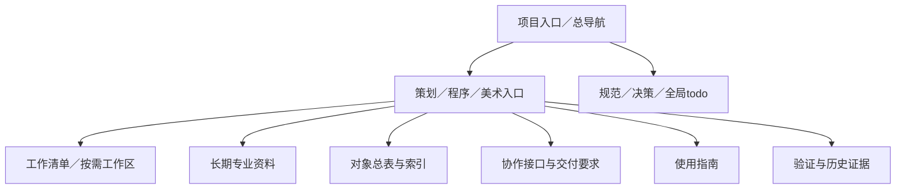

# 文档用途、维护与协作规范

| 字段 | 内容 |
| --- | --- |
| 文档ID | production.documentation-standard |
| 类型／负责人 | 规范／策划制定；各角色执行自己的辖区 |
| 用途／读者 | 项目治理与协调／策划、程序、美术 |
| 维护方式 | 持续维护 |
| 生命周期／修订／更新 | 当前／2.0／2026-10-22 |
| 适用范围 | 三个Agent的工作稿、长期资料、总表、接口、指南、证据与项目治理 |
| 依据／关联 | 用户2026-10-22明确采用用途分类；CS-077～080；[ADR-022](../decisions/ADR-022-documentation-governance.md) |

## 1 用途分类

每份文档选一个主要用途；可以有多个读者。负责人决定谁维护，读者决定谁需要阅读；内部使用不表示其他角色不能读，跨角色使用也不表示所有角色都可写。

| 主要用途 | 内容与典型对象 | 维护要求 |
| --- | --- | --- |
| 任务工作区 | 特定任务的中间方案、排查、未定试验 | 每任务集中一份工作记录，标任务ID、问题、结论去向与结束条件；不代替正式规则 |
| 长期专业资料 | 玩法、架构、美术风格、研究与制作经验 | 固定主题原地维护；当前规则、未采用提案与历史依据分开 |
| 对象总表与索引 | 人物、武器、组件、素材总表、画廊与导航 | 一类对象一个权威总表；索引引用源，不重复维护参数／资产登记 |
| 协作接口与交付要求 | 素材接入、事件协议、制作任务、验收契约 | 明确提供方、使用方、版本、责任、失败／退回和变更影响 |
| 使用指南 | 测试场、HUD编辑器、预览工具的操作方法 | 面向实际使用者写前置、步骤、结果、保存／恢复、常见错误；实现原理另归专业资料 |
| 验证与历史证据 | 测试、试玩、确认依据、失败样本与审查快照 | 绑定版本／环境，保留当时通过、失败、未测；新结果另记，不改写旧结论 |
| 项目治理与协调 | AGENTS、全局todo、文档规范、项目决策 | 指定主维护者与修改权限；共用事实不产生多份平行状态表 |

总表可以兼有完整规则；例如人物仍按用户要求集中在characters.md，武器仍在weapons.md。无需为了分类把同一正文拆成内部版／外部版。简短文档可分节兼顾读者；工具说明一旦同时承载大量实现细节和操作流程，应分离指南并引用同一事实源。

## 2 生命周期与任务结束

用途不决定是否临时：设计可能长期维护，测试报告可能永久留证。元信息分别写主要用途／读者、维护方式与已有生命周期，不能用文件日期猜是否过时。

| 维护方式 | 进入与退出规则 |
| --- | --- |
| 任务临时 | 任务进行时使用；结束时将有效结论写回长期源，独特失败／复现依据转留证，已完整合并的纯重复稿可删除 |
| 持续维护 | 当前规则、接口、指南、索引与计划原地更新；改动须同步必要入链和任务 |
| 历史留证 | 保存原时点证据，标被测对象与局限；不承担当前参数／当前采用状态 |

生命周期沿草拟／当前／已替代／归档使用。“当前”只代表当前阅读源，不等于用户确认、实现或验收。工作区不强制每任务建文件；没有实际中间记录就不建空稿。聊天转发话术直接在聊天提供，其中影响执行的事实整理为正式任务定义。

任务结束前逐份决定：继续维护、提炼合并、留证或删除。删除前核对引用与恢复能力；未跟踪文件不能假定Git已有备份。临时稿不一律归档，原始许可、用户依据、独特失败证据和有效接口不能当垃圾清除。

## 3 入口、唯一源与权限

入口按角色保留，每个角色README按“我的工作、长期资料、对象总表、协作接口、使用指南、验证／历史”组织阅读；项目治理从总导航进入。没有内容的类别用一句话说明，不造空目录／占位正文。

| 事实 | 唯一维护源与负责人 |
| --- | --- |
| 阶段、全局优先级、CS交付包 | 根todo／策划；各角色自己的todo维护ART／DEV内部拆分 |
| 玩法与设计参数 | design主题源／策划；算术附表不覆盖规则 |
| 实际行为、配置与当前构建 | game及程序采用入口／程序；与设计差异登记任务 |
| 可编辑资产、来源许可与导出 | assets及manifest／美术；画廊和类别页是引用视图 |
| 运行副本与精确素材版本 | runtime-manifest／程序；新导出不代表已接入 |
| 用户指令与决策 | 决策／原始依据；已确认决定和后续明确用户指令优先 |

根todo保持一个主维护者，各角色不同时随意改全局状态。接口可共同讨论，但需指定主维护者；跨角色修改在CS任务登记，由原角色执行或按明确授权修改。新文档必须从总导航经直接索引可达，工作稿经任务链接可达，不进入默认规则阅读。

## 4 元信息、正文与模板

当前与新建文档开头必填：文档ID、类型／负责人、用途／读者、维护方式、生命周期／修订／更新、适用范围、依据／关联。文档ID和对象ID稳定且不复用。历史快照不为补格式强改原始字节，分类可登记在证据索引。

| 正文对象 | 要说明的内容 | 模板 |
| --- | --- | --- |
| 规则／专业资料 | 定位、规则／失败、参数与单位、采用范围、确认／实测边界 | [design](templates/design.md) |
| 总表／索引 | 覆盖对象、稳定ID、详情、维护源、交付／证据位置 | [catalog](templates/catalog.md) |
| 程序组件 | 输入输出／权威、生命周期、依赖、配置、恢复 | [component](templates/component.md) |
| 美术资产 | 预览、源／许可、接口、版本、检查与实际接入 | [asset](templates/asset.md) |
| 接口／交接 | 目标、唯一输入、提供方／使用方、交付、验收、退回 | [handoff](templates/handoff.md) |
| 使用指南 | 读者任务、前置、操作、预期、保存／撤销、问题排查 | [guide](templates/guide.md) |
| 任务工作稿 | 任务、未定问题、尝试与证据、结论去向、结束处理 | [work](templates/work.md) |
| 验证报告 | 版本／环境、步骤／预期、实际、失败／未测、证据 | [validation](templates/validation.md) |

正文用Markdown，结构／流程用Mermaid。设计正文原则上≤150行，推导移附表；不压成巨长单行。用户要求全员人物设定集中在一个文件，characters.md作为明确例外保留完整正文。来源／许可、数值单位与竞态条件不能为行数省略。

## 5 路径、迁移与归档

目录按维护责任保留，读取类别通过索引区分；不建立一套内部正文再复制到对外目录。当前权威源、工具读取的固定路径不为分类强搬；安全可移的独立记录可集中到本领域evidence等子目录，路径规则见[目录规范](project-structure.md)。

迁移前查Markdown、脚本、配置、原始日志／快照与跨角色消费者。路径被使用不等于必须搬；必要时原位标用途，在处置清单登记约束。原始快照中出现旧路径与程序仍实时读取旧路径要区分，不回写快照伪造历史。

归档仍用docs/archive/<原领域>/<年份>/<原相对路径>。有后继且含独特依据的旧资料归档，完整合并的纯重复可删；不按年龄删除有效提案。记录原路径、后继、理由、迁移前／后指纹并修入链／文内图片。因只读消费者暂留的跳转须标已替代、后继、归档与清理任务；解除依赖后删除，不累积长期跳转。

默认规则检索排除archive、evidence及work；追查依据或当前任务时显式进入。检索排除不影响索引可达性。历史报告不得当作当前规则、运行构建或用户新确认。

## 6 完成与检查

完成一次整理须交源文／索引、处置清单、任务与检查证据；一轮汇总一份报告，不为每次微小修改新造报告。自检包含用途／读者／维护方式、唯一源、直接可达、入链／图片／工具依赖、稳定ID和辖区。目录整理完成不代表玩法或素材已通过。

证据区分文档自检、独立资产、引擎、同机、真实LAN、设备、性能、真人与用户确认。引用旧验证不算本轮重测。跨角色整理按[CS-078／079交接](documentation-handoff.md)，策划沿CS-080复核，不接管对方工作区或代报完成。
