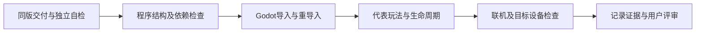

# 美术素材交接总则与分类入口 v1

| 字段 | 内容 |
| --- | --- |
| 文档ID | tech.asset-integration |
| 类型／负责人 | 接口规范／程序 |
| 用途／读者 | 协作接口与交付要求／程序、美术；策划按需 |
| 维护方式 | 持续维护 |
| 生命周期／修订／更新 | 当前／1.1／2026-10-22 |
| 适用范围 | 本文主题；空缺与待评审字段不视为已实现／已验收 |
| 依据／关联 | CS-056；[采用构建](current-build.md)；本文保留原交付日期与证据 |

> 本页原时点正文／数值／验证结论保留；统一源码身份以[采用构建](current-build.md)为准。

环境物品实现：[环境破坏物运行接入](interactive-props-v1.md)，支持静态道具模板复用与模型几何烘焙；当前消防栓是程序临时模型，正式素材和全城切换另行验收。

后续程序实现：[重构v1](refactor-v1.md)已接入运行定义目录及角色／武器／命中资料校验。以下交接要求和首件验收仍有效；静态物品模板／导入烘焙已实现，带骨架物品、正式特效音频与通用事件执行器仍需独立适配。

2026-10-20 · 程序 DEV-049 · 用户授权整理文档，待美术／导演评审。替代早期接口问题单，历史内容见Git记录；本次不新增素材、导入器或玩法。已确认的ADR优先于本文提案，用户后续指令优先于旧ADR。

## 先选分类

| 类型 | 交接规范 | 当前证据与边界 |
| --- | --- | --- |
| 人物／敌人及动画 | [人物与动画](character-animation-handoff-v1.md) | 锋刃v002、钳牙兵v001已有游戏接入；新骨架／外部动作仍需试验 |
| 武器 | [武器](weapon-handoff-v1.md) | 步枪v002与锋刃v002已有配套接入；不是任意武器自动适配 |
| 可交互物品 | [可交互物品](interactive-prop-handoff-v1.md) | 当前交付提案，尚无正式美术样件完成该整套验证 |
| 特效／音效 | [特效与音效](effects-audio-handoff-v1.md) | 现有程序反馈可参考，正式素材导入、生命周期与预算待验证 |
| 地图／静态环境 | [地图交接与后处理](map-streaming-contract-v1.md) | v002分块流程已实现，字段待跨角色评审；逐栋破坏未实现 |

规范可以叠加：带动画补给箱遵守物品规范和人物页的通用动画条款；炮塔再补武器接口。没有使用的能力写“不适用”，不为凑齐分类增加素材或玩法。

## 谁负责什么

| 角色 | 责任与交付 |
| --- | --- |
| 导演／策划 | 用途、玩法状态、优先级、可读性、验收场景；协调接口变化和跨角色评审 |
| 美术 | 唯一可编辑源、版本化导出、依赖、尺寸／节点／片段说明、来源许可、预览和独立自检；维护美术登记与画廊 |
| 程序 | 复制／转换、运行追溯、导入设置、挂点适配、碰撞／命中、状态同步、清理与游戏内验证；维护程序记录 |

接口差异写进交接记录和各自todo，由导演协调；不跨会话自动发消息，不替其他角色标完成。只有用户可以标“已确认”。

## 所有类型的基础要求

- 稳定`asset_id`，导出版本用`vNNN`；新增版本不覆盖旧版，依赖写到精确版本，不能只写“最新”。配套升级记录角色、武器、动画、材质等兼容组合。
- 遵循[目录规则](../production/project-structure.md)：唯一源在`assets/source/`或已登记的生成脚本；导出在`assets/exports/`，预览在`assets/previews/`，程序副本在`game/assets/`。脚本生成的blend可为快照，必须明确，不能两份各改。
- 三维接口以Godot导出空间米制、+Y向上、朝向−Z为本轮统一候选；人物按[ADR-014](../decisions/ADR-014-character-asset-interface.md)执行。非定向物体写明基准朝向。源软件坐标转换、原点和根变换均需记录，不能靠运行时试缩放消除问题。
- 现有人物／武器采用GLB；新三维样件优先沿用，骨架／材质／动画有损失时先做小样。图片／音频格式按分类规范选择；不要将某种格式名当作导入通过。
- 交付列全网格、骨架、纹理、动画及外部依赖；不得依赖个人机器绝对路径。纹理角色、分辨率、透明／发光模式须说明，预览相机／灯光不得混入游戏模型导出。
- 数值记录单位；变换记录父节点、位置米、旋转表示与顺序、缩放。重名节点需完整路径；名称大小写敏感。稳定ID和接口名不要随导出排序变化。
- 性能先记录实数：三角面、材质／表面数、骨骼数、纹理尺寸、实例数、透明覆盖、粒子／音源峰值等。ADR-014的M1角色约束继续有效；不编造适用于全项目的统一面数／帧率预算。
- 记录原创／生成／第三方来源、许可、修改与下载情况；复用仓库已有资源。新的外部动画下载按ADR-014取得授权，不能把规范整理当成下载或付费制作授权。

## 每次交付的记录模板

将以下内容填入该资产自己的美术交接`.md`，不必复制一份总规范。既有`interface.json`可继续作为配套数据，链接它即可；**本模板是文档约定，不是已实现的JSON schema或通用加载器**。

| 字段 | 必填内容 |
| --- | --- |
| 身份／用途 | asset_id、vNNN、分类、对应任务、用途与不适用项 |
| 源与重建 | 唯一编辑源、作者／生成器、工具版本、导出设置、重建命令或手工步骤 |
| 文件与校验 | 仓库相对路径、每个导出／外部依赖的SHA256、大小；预览与报告链接 |
| 来源与许可 | 原创／第三方／生成服务，来源记录与许可限制 |
| 空间／接口 | 单位、轴、原点、尺寸、节点／骨骼／插槽；二维／音频不适用项注明 |
| 动作／状态 | 片段／状态表、时长、循环、事件、驱动责任、打断／复位方式；无动画注明 |
| 兼容与成本 | 精确配套版本、节点／骨架变化、资源统计、代表实例数、降级建议 |
| 检查与缺口 | 实际引擎／平台／场景、已做步骤与结果、已知问题、下轮需要谁处理 |

程序复制或转换后将源与运行资源SHA、导入配置、生成器／引擎版本记入运行追溯。现有入口是[runtime-manifest.json](../../game/assets/runtime-manifest.json)，地图另有后处理索引；不要求美术写程序副本。不手改Godot缓存文件代替修改源或导入设置。

## 验证与变更

每一层单独记录“未做／通过／失败／不适用”和证据：文档／结构、独立资产、引擎、实际玩法、多人、设备性能、用户评审。已有报告只覆盖原版本和原场景；独立导入或漂亮截图不能替代玩法验证。

首次接入每类只做一个代表样件。重导出后检查挂点／材质覆盖是否保留；改骨架／原点／挂点／片段名时列出破坏性变化和迁移方案，程序重新生成派生数据并回归。美术新版本不自动替换当前游戏版本。

若暂不支持某能力，先保留已验证版本或明确的灰盒表现，不悄悄改尺寸、填满资源、跳过碰撞或新增玩法。发布与回退以精确版本及配置组合为单位。

首轮执行清单见[分类交接核对清单](../qa/asset-handoff-v1-checklist.md)。本轮仅整理规范和已有证据，没有声称完成新样件实验、通用重定向、通用事件解析、物品导入器或特效音频资产管线。
