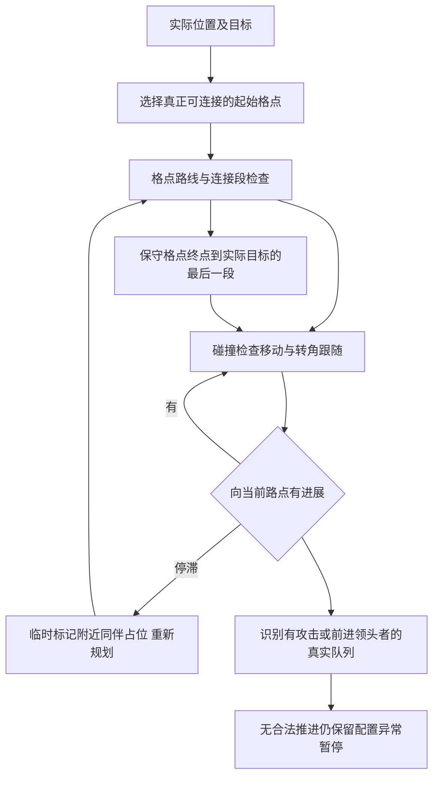

# CBD通路恢复：Q1通行与恢复

| 字段 | 内容 |
| --- | --- |
| 文档ID | tech.cbd-path-recovery |
| 类型／负责人 | 程序组件／程序 |
| 用途／读者 | 长期专业资料／程序维护者；策划按需 |
| 维护方式 | 持续维护 |
| 生命周期／修订／更新 | 当前／1.2／2026-10-22 |
| 适用范围 | CS-065 P01／P02、DEV-077修复候选；不代替Q2～Q4与真人验收 |
| 依据／关联 | [钳牙威胁方案](../design/m1-qianya-pressure.md)、[CBD交接](../production/m1-cbd-handoff.md#钳牙威胁试玩退回cs-065)、[本批QA](../qa/2026-10-21-cbd-path-recovery-validation.md) |

## 结果与职责

本批修两类已复现问题：同伴挡路时局部避让反复返回旧路径，以及小型街具两侧格点可站但连接段不可走。导航始终保持实际碰撞；没有关闭整类道具、缩模型／身体双钳命中，或传送／删活怪计击杀。

静态样例在v005合批网格`Props_11_10`／块`c_11_10`，约世界X310、Z310米，见[原始命中与连接段](../qa/cbd-pressure/static-obstacle.json)。运行合批网格内没有独立街具实例ID，本批不能据此指定某个美术原件名称；问题在导航连接段，不要求美术重做整图。

## 输入输出与权威

[Navigation](../../game/core/navigation.gd)只在房主计算路径；读取同版地面／障碍、实际敌人占位与目标，输出方向及宿主私有恢复状态。[SimulationQueries](../../game/core/simulation_queries.gd)提供静态通行与队列原因，[World](../../game/core/world.gd)按既有地面移动算法提交位置并发诊断事件。玩家预测、弹道、敌人受击和美术源未替换。



## 生命周期与恢复

- Q1使用与实际移动相同的静态通行查询和原敌人包络，检验起始连接及转角跳点；相邻格点之间也检验连接段。薄街具导致连接无效时，本次规划暂避该格点，之后恢复共享网格；静态连接缓存随障碍指纹清空。单次计划限制尝试次数，不无限重算。
- 按朝路点的进展和独立0.5米身体位置锚发现停滞（换路点不重置身体进展），触发恢复；恢复计划临时标记附近同伴的保守占位；预留无解时重新生成通向当前目标的静态路径，起点连接仍逐段检查实际同伴间距，不沿用过期终点。静态图与身体碰撞不改。队列有机会通行后继续接近；临时规划终点不冒充真实攻击位置，末段仍走原碰撞检查移动。
- 入场恢复保留所属门的约束；通过approach后不再强制回到已通过的转角。开波／重开沿原生命周期清理或重建，路径和缓存不进入网络快照。
- `cbd_repath`记录敌人、位置、路点、进展停滞秒数与次数；`cbd_queue`／`cbd_queue_released`记录等待／解除及领头者链。队列必须沿更接近同一目标的同伴，最终关联真实攻击者或有位置进展者；不以原地摆动免除失败。无合法推进仍沿既有有界配置异常暂停。

## 配置与运行

独立[Q1配置](../../game/config/m1-cbd-q1.json)启用`cbd.path_recovery`；默认false，旧M1／自由跑图等不进入新路径。对照[Q0配置](../../game/config/m1-cbd-q0.json)保留本轮起点的原CBD通路行为；Q0同样继承此前动作／俯仰修复，不宣称复原用户未记录的旧构建哈希。

```sh
tools/playtest/start_game.sh host --config res://config/m1-cbd-q1.json
tools/playtest/start_game.sh host --config res://config/m1-cbd-q0.json
```

两预设有效配置差异仅布尔开关，见[逐字段对照](../qa/cbd-pressure/config-diff.json)；战斗参数和地图／素材不变。对比时重新建局，客户端采用相同源码和完整配置。没有新ZIP。

## 验证与未关闭项

[QA](../qa/2026-10-21-cbd-path-recovery-validation.md)给出五个25秒原版停滞反例、修复结果、真实5／8只队列、静态网格一致性、原模式／三波／主场景／ENet回归。队列夹具关闭伤害以隔离移动；正常资源脚本三波另验，均不替代真人。

首批[原QA](../qa/2026-10-21-cbd-path-recovery-validation.md)保留当时两段约2.07／2.20秒的失败事实。[后续QA](../qa/2026-10-21-cbd-pressure-validation.md)收尾位置计时重置／过期路径，并修22只公交复测暴露的动态起始连接问题。三门和花箱／公交／站棚、不同数量追移动目标分别留证；不把有限点位测试称为整图穷举通过。

Q2～Q4已按[威胁组件](cbd-pressure.md)提供独立试验入口；真人、真实两机／目标设备及平衡确认仍独立待验。菜单当前采用和负载结论从[当前构建](current-build.md)查，不再由本页维护。
