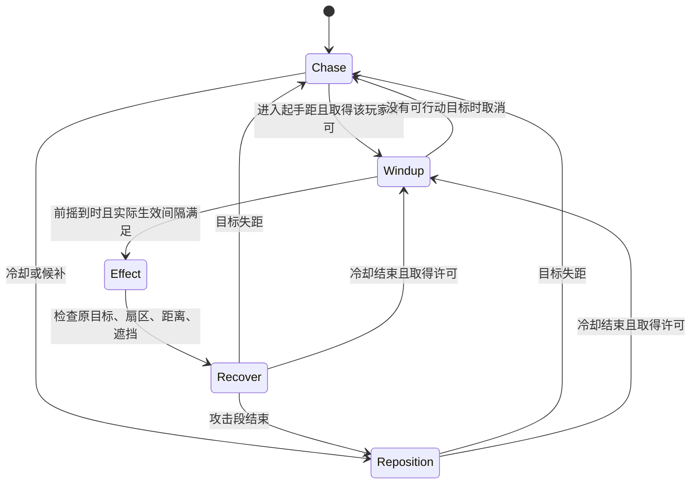

# CBD钳牙威胁分组试验

| 字段 | 内容 |
| --- | --- |
| 文档ID | tech.cbd-pressure |
| 类型／负责人 | 程序组件／程序 |
| 用途／读者 | 长期专业资料／程序维护者；策划按需 |
| 维护方式 | 持续维护 |
| 生命周期／修订／更新 | 当前／1.1／2026-10-22 |
| 适用范围 | CS-065 Q1收尾、Q2／Q3／Q4试验实现与回退 |
| 依据／关联 | [策划参数源](../design/m1-qianya-pressure.md)、[补充交接](../production/m1-cbd-handoff.md#钳牙威胁试玩退回cs-065)、[验证](../qa/2026-10-21-cbd-pressure-validation.md) |

## 职责与采用范围

用户授权按Q0～Q4试一版。当前菜单CBD进入Q4试验，独立保留Q0～Q3；这是可玩候选，不是新平衡参数的用户确认。地图／素材版本及源码身份以[采用构建](current-build.md)为准。

[通路组件](cbd-path-recovery.md)负责移动；[cbd_melee.gd](../../game/core/cbd_melee.gd)负责房主攻击许可、锁向和实际生效；[cbd_wave_mode.gd](../../game/core/cbd_wave_mode.gd)继续负责有限请求、隐藏／距离／预告、上限和恢复。没有增加敌种、血量、伤害或命中尺寸。

## 输入输出与权威

每个预设是可独立加载的完整覆盖，最终合并defaults并校验／计算有效配置哈希。运行时不热改正在进行的局次；比较时重建房间，客户端使用相同源码和覆盖。

| 入口 | 对照用途 |
| --- | --- |
| [Q0](../../game/config/m1-cbd-q0.json) | 原通路及战斗参数；继承共同的俯仰／人物动作修复和已有碰撞工作，不冒充用户未记录的旧构建 |
| [Q1](../../game/config/m1-cbd-q1.json) | 通路修复，原战斗参数 |
| [Q2](../../game/config/m1-cbd-q2.json) | 在Q1上只提高接近速度 |
| [Q3](../../game/config/m1-cbd-q3.json) | 再提高起手／冷却积极度，启用攻击许可、锁向和错峰 |
| [Q4](../../game/config/m1-cbd-q4.json)／[菜单候选](../../game/config/m1-cbd.json) | 再提高有限兵力、上限及发兵频率；两文件语义相同 |

具体数值只在策划源与上述运行配置维护；[构建器](../../tools/analysis/build_cbd_presets.py)从Q1生成Q2～Q4和菜单候选，`--check`检查漂移。逐字段差异与哈希见[QA配置证据](../qa/cbd-pressure-followup/config-diff.json)。

## 生命周期与攻击状态

- Q3／Q4每玩家最多2只同时前摇。房主为预期生效时间申请许可；实际生效另有时钟保护，低频／长步长也不能把两次效果挤到同一帧。落空同样占用该效果时间。
- 起手后保持原目标和朝向；生效时重新检查目标在线／存活、与起手相同的中心距离、100°正面扇区和遮挡。不会在前摇中持续追身旋转，也不会隔墙补伤害。
- 冷却从生效起计，包含现有攻击／恢复段；没有再叠加完整恢复时间。目标失距可追，候补者按合法路径接近／绕位。实际身体间距仍受碰撞约束，窄口与拥挤前排允许真实队列。
- [EnemyHitboxes](../../game/core/enemy_hitboxes.gd)是渲染和动态受击共用的动作时钟；Q2以后chase按速度相对原CBD步频缩放。Q3追逐冷却中的目标时选择chase，锁向前摇按起手时刻采样；延迟生效会停在前摇末姿态。
- 攻击许可／实际效果时钟只在房主，重开清空。快照仅增加动作需要的`pursuing`／`windup_started_at`，不发送导航、许可字典和观测缓存。协议号仍13，不能据此混用旧源码客户端。

## 有限调度与恢复

Q4请求表采用策划12／18／24次、3秒格点和既有门ID；人数在开波锁定，批量仍N+1，部分放行保留门与余量。初始化、实际生成限制、恢复均读取当前`batch_interval`。Q4允许在间隔到期前开始完整预警，实际放行仍同时满足间隔及预警到期，避免额外叠加一次预警时长。

无人可行动时清预警、停刷；恢复后重新走完整预警，不能补发拥挤批次。原Q0～Q3／旧模式保留原间隔；隐藏H、净距、侧潮实际显形差和有界配置异常继续执行。重开清敌人、事件／许可和观测，保留既有每局自救／资源规则；没有用本批代替CS-051／052完整矩阵。

## 可观测性

`cbd_spawn`、`cbd_visible`逐敌人记录出生／首次可见；`cbd_entry`记录到E；`cbd_contact`记录首次达到起手中心距；Q3／Q4另记`cbd_attack_start`／`cbd_attack_effect`。门级`cbd_first_visible`继续约束侧潮。事件沿现有有界事件队列输出，收集器须每步去重消费；房主不保留无限历史。

[正常资源采样脚本](../../game/tests/cbd_pressure_combat.gd)逐秒记录总在场、尚未到E、可交战和近战数。可交战定义为在武器射程内且胸部视线无遮挡，按全方向计算，不能当玩家当前视野；“未到E”可与可交战重叠。敌人在到E／近身前被击杀时，后续时间为空，不能填零或当作到达。

## 验证与缺口

[本批QA](../qa/2026-10-21-cbd-pressure-validation.md)区分受控移动、单敌时钟、群体输入、有限调度、正常资源脚本、实际主场景、回环ENet及本机负载。各预设可从菜单选择，也可用启动器`host --config res://config/m1-cbd-qN.json`；回退优先Q4→Q3→Q2→Q1，保留通路修复。

真人两枪各三局及原话由CS-066接续；真实LAN、Windows、物理手柄、目标机长局性能和空间偏差评审没有因脚本通过而完成。没有生成新ZIP或自动提交。
