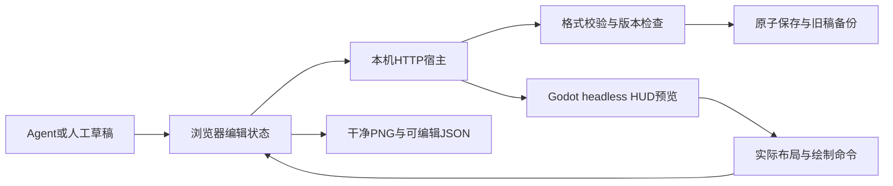

# UI编辑工具实现与生命周期

| 字段 | 内容 |
| --- | --- |
| 文档ID | tech.hud-layout-editor |
| 类型／负责人 | 工具组件／程序 |
| 用途／读者 | 长期专业资料／程序维护者 |
| 维护方式 | 持续维护 |
| 生命周期／修订／更新 | 当前／1.4／2026-10-22 |
| 适用范围 | 通用页面与HUD编辑器的依赖、状态、保存／恢复和验证边界 |
| 依据／关联 | DEV-094～096；DEV-093／CS-078文档分类；[人工与Agent指南](guides/ui-editor.md)、[数据接口](ui-layout-contract.md)、[HUD组件](combat-hud.md) |

## 职责与非职责

本地编辑工具服务同一项目内的两类表现文档：通用界面草稿用于“可编辑结构示意→PNG生成参考→导入独立素材→正式视觉排版→Agent编码实现”；运行HUD布局用于游戏既有元素排版。共享HTTP宿主和静态文件服务，不共享JSON格式或游戏状态权威。人工操作只在[指南](guides/ui-editor.md)维护，提供方／使用方、字段、限制与兼容只在[接口](ui-layout-contract.md)维护。

工具不生成付费素材、不修改素材母版或许可、不自动发布UI，不包含游戏菜单行为、交互连线或通用Godot场景导出。当前采用与历史交付只从[current-build](current-build.md)及QA入口读取。

## 输入输出与依赖

[server.py](../../tools/playtest/hud_editor/server.py)使用Python标准库本机HTTP服务；只将白名单静态文件与素材交给浏览器，不自动打开窗口。通用画布由[studio.js](../../tools/playtest/hud_editor/studio.js)渲染，[模型与模板](../../tools/playtest/hud_editor/studio-model.js)提供节点和参考几何，[验证器](../../tools/playtest/hud_editor/studio_document.py)约束文档。图片内嵌，交接不依赖用户原文件路径。

[HUD前端](../../tools/playtest/hud_editor/editor.js)使用原PNG和实际Godot标签／几何；预览通过[夹具](../../game/tests/hud_layout_preview.gd)加载当前HUD类，不是另造一份游戏状态规则。浏览器字体栅格化与引擎GPU不同。通用页面不调用Godot，不将浏览器图当作游戏帧。

## 生命周期与状态

载入完成后保留保存基线、版本和编辑草稿；操作进入有界撤销／重做历史。通用编辑历史共享不可变图片资源，避免每次拖拽复制base64；文档／图层结构独立保存。页面选择和缩放为本机会话视图状态，保存内容只按接口文档格式输出。

通用文档导入先校验并解码图片，失败不替换当前稿。载入／导入期间若发生新编辑，旧结果不应用。保存捕获请求时版本，返回成功只更新该份基线，较新编辑继续保持未保存；冲突不强制覆盖。HUD前端采用同样的版本与异步保护原则。

干净PNG复制不含选择框的画布，再恢复编辑视图；只导出当前页面，完整JSON保留全部页与图片。导出不改变布局，不等于正式接入或人工确认。服务退出不持有未保存的浏览器稿；保存路径与恢复步骤归指南。

## 选择、批量操作与扁平组

通用前端使用node／group引用组成选择集；去除重复以及同一组与其成员的重叠选择。修饰键点击与完全包含式框选只改变选择，不写撤销历史。锁定成员及其所在整体不能误移动；输入控件持有焦点时，画布编辑快捷键停用。

组是逻辑成员表，成员仍留在page.elements中。成组、解组、移动、复制不隐式改变原有绘制顺序；单独的移层操作才改变它。图层树展示一层组／成员，组行按最上方成员排序；成员与组外元素原本穿插时，这个树不代表连续的绘制块。v3增加Frame父子容器，组本身仍无组变换矩阵或嵌套组。

组边界取所有成员矩形的并集，包括隐藏成员。组与散选按整体边界对齐／分布；水平／垂直分布保留选择外跨度，按边界空隙计算，可出现负间距重叠。解组把父级显示／锁定合并到成员，保持外观与保护；少于两个成员的组自动解除，同样传递这些状态。

每次批量变更记录一份文档／活动页／选择状态；拖动在首次实际位移时记录，整个手势只占一步。历史最多80步，图片对象不可变并共享。复制缓存属于当前文档会话，切页保留，载入／导入清空；粘贴创建新元素／组ID，图片沿用资源引用。

原有图片元素可从属性栏改用已导入资源；本轮增加“上传并替换所选图片”。资源按MIME与图片数据复用，替换仅改所选节点的asset引用。解码完成后比较编辑序号、活动页与选择；失败或过时结果不改文档，也不占撤销步骤。

## Frame模型与工作台

v3在同一elements表增加Frame节点和parent引用；子项使用父级局部坐标，根层继续原预览锚点，几何解析统一在studio-model.js。paintOrder按同父级相对顺序递归Frame子树；逻辑组仍独立，不把旧稿穿插图层静默改成树绘制。升级由明确Frame操作触发，旧v1／v2读取不迁移。

移动操作只改选择集的最高祖先坐标；复制／删除遍历完整子树。normalize去掉祖先与后代重复选择，避免移动两次；复制重映射parent与组成员，历史保存整份结构，图片仍共享。解码／导入／载入／保存原有并发保护继续适用，上传新增图片也捕获选择及目标父级。

可见、锁定、透明度按祖先链计算，不重写子项开关；解除Frame才合入移除父级的必要显示／透明度。层级校验集中于Python验证器，限制深度、父级类型、循环与同父级组成员；/api/document/schema描述当前能力，字段错误返回路径，供Agent修正。

前端保留原生JS／Canvas与既有依赖。页面／图层树、画布面包屑、上下文属性分区独立；图层支持折叠和键盘导航，选择后属性滚动归顶。复制／粘贴始终在顶栏，避免空目标页失去入口；帮助弹窗和输入控件屏蔽画布快捷键。HUD复用同一视觉CSS，原有渲染／保存适配器保持。

## 文件、预览与失败恢复

保存采用专用锁、当前字节版本比较、旧稿备份和同目录临时文件替换；通用文档路径不得等同运行HUD路径。预览另用临时JSON与headless子进程，有独立锁和超时，不能因预览改运行布局。HTTP错误语义和验证边界归[数据接口](ui-layout-contract.md)。

HUD运行回读由[CombatHUD](combat-hud.md)负责：F8成功才替换有效布局，失败保留旧布局。本地布局不参与战斗配置指纹，UI运行素材仍按素材清单身份验证；工具不能热改战斗资源。

## 验证与维护边界

[前批批量／分组QA](../qa/2026-10-22-ui-studio-batch-validation.md)绑定当前工具源码及独立测试稿，包含旧模式回归。

[通用编辑器原批QA](../qa/2026-10-22-ui-studio-validation.md)及[HUD原批QA](../qa/2026-10-22-hud-editor-validation.md)绑定当时源码与环境。本轮文档拆分核对见[CS-078报告](evidence/2026-10-22-documentation-review.md)，没有因整理改变源代码、格式、采用值或原始测试结果。

本批Frame及工作台验证见[DEV-094～096 QA](../qa/2026-10-22-ui-studio-frames-validation.md)，分别报告Agent和人工操作检查，未把程序自动化演练称为真人易用性验收。自动布局、组件实例和游戏接入继续不在本批范围。

增加数据字段须同步验证器、前端消费者与接口；改变操作须同步指南和对应验证。复杂度／大图性能、真人编辑便利性、跨机器、游戏新菜单接入、Godot字体／GPU一致性和概念生成保真仍独立待验。
