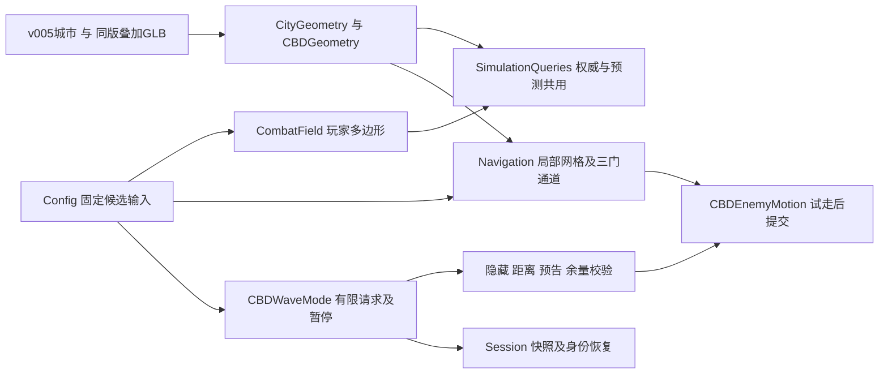

# CBD 三波程序联调

| 字段 | 内容 |
| --- | --- |
| 文档ID | tech.m1-cbd-integration |
| 类型／负责人 | 实现与交接／程序 |
| 用途／读者 | 长期专业资料／程序维护者；策划按需 |
| 维护方式 | 持续维护 |
| 生命周期／修订／更新 | 当前／1.3／2026-10-22 |
| 适用范围 | CS-034、DEV-071～073；v005同版候选，非真人／真实LAN验收 |
| 依据／关联 | [CBD交接](../production/m1-cbd-handoff.md)、[设计源](../design/m1-cbd-battlefield.md)、[美术同版包](../art/environment/m1-cbd-layout.md)、[修正G01～05](../production/m1-rule-fixes-handoff.md) |

## 结果与采用范围

已交可运行的**v005城市＋CBD美术v001叠加包**：T形活动域、公交／花箱／站棚真实网格、独立敌人入场导航、有限三波、人数批量、全员遮挡生成、部分批余量、异常暂停和恢复。当前菜单名从[采用构建](current-build.md)查；[当前构建](current-build.md)标识源码，[QA报告](../qa/2026-10-20-m1-cbd-validation.md)列实际验证。

本轮先在v002完成程序基线，随后接入制作中刚交付的v005同版包并重测。旧v002／绿地、自由跑图和旧任务保留；初版数据保存在[原基线](../qa/m1-cbd/v002-program-baseline/source-snapshot.json)，不与最终结果合并。正式摆放与9车域外遮挡仍为待评审候选，未代改策划源／根todo或美术状态。

## 运行、输入与重建

```sh
tools/playtest/start_game.sh host --config res://config/m1-cbd.json
tools/playtest/start_game.sh join 192.168.1.20 --config res://config/m1-cbd.json --profile cbd_client
```

E／LB开始；失败／胜利可重开；入口异常时房主点“返回准备重试”，客户端等待房主。主武器无限备弹保留正常弹匣／换弹；测试火箭槽保留，未作为通关依赖。

CS-034原交付运行覆盖（当前值已沿后续试验更新）：[m1-cbd.json](../../game/config/m1-cbd.json)，继承[defaults](../../game/config/defaults.json)；三波请求按策划源表录入，波开始锁定在线人类数。合并配置与哈希见[logic.json](../qa/m1-cbd/logic.json)的`evidence`，地图／叠加GLB来源与SHA见[runtime-manifest](../../game/assets/runtime-manifest.json)。母版、素材原源未修改。

地图原生化复用[handoff-cbd-v005](../../tools/analysis/city_stream/handoff-cbd-v005.json)和原生产器；新增`--no-activate`只登记构建，不更换所有旧关卡的默认地图。v005只由CBD覆盖选择；原默认仍为v002。

```sh
python3 tools/validation/build_city_traversal.py --source assets/source/environment/lujiazui_city/v005/scene_data.json --output game/assets/environment/lujiazui_v005/traversal.json
python3 tools/analysis/city_stream/build_city_stream.py --handoff tools/analysis/city_stream/handoff-cbd-v005.json --no-activate
python3 tools/analysis/city_stream/build_city_stream.py --handoff tools/analysis/city_stream/handoff-cbd-v005.json --check
```

原GLB／catalog须先按配方路径逐字节复制并导入。输出304块、3951个原网格，build_60377e07fa1026da；[生成记录](../qa/m1-cbd/cook-v005.json)／[复核](../qa/m1-cbd/cook-check.json)绑定源与产物哈希。遍历边界由同版地理按原适配规则生成，未烘焙全城1米导航。

## 程序结构与权威



- 玩家合法性、预测和黄色测量线共享同一多边形；子步碰撞处理长位移。测量线是CS-034联调表现，**未交CS-048渐显投影**。
- 敌人用局部1米网格和独立域外导航域，半径1.3米。每门在域内只开放自己的入场通道，先经同组固定绕车出口，再到E后追击，避免同批分走两端发生交叉。未缩模型，身体／双钳命中原规则保留。
- 核心4个实体网格＋9个域外公交主体按美术catalog只建一次碰撞；装饰不重复建实体，不加载`review_context.glb`。枪弹／导航／移动取同一世界变换；相机用同版网格物理体，未填站棚包络为实心墙。封闭车身内部不可投放，站棚空腔另有反例检查。
- 用美术五只队列或已验证路线队列逐点检查净距、地面、路径、全员视线及肩后／高视点；局部避让先用共用碰撞查询试走再提交，不穿同伴。静态采样不替代运行期检查。
- 固定6／9／12个准入请求；B=N+1，总量／上限按波开始人数锁定。未放完批次保留门点和余量；实际生成间隔≥5秒，预告≥1.5秒。
- 侧门等待实际主潮首次可见后≥10秒再准入；日志分开记录首次可见和到E。无行动者取消预告、保留余量，恢复后完整重预告；等待／满额不累计入口异常，合法出兵归零。
- 无合法H每秒重试，累计10秒有效受阻进入`config_error`；卡路也记录位置并暂停。暂停冻结模拟、不提交胜负／奖励，只有房主可重开，不传送／删除残兵掩盖问题。
- CBD先完成弹体伤害再裁决清波；整备保留自救消耗。此批只覆盖CBD相关反例，**未代关CS-051／052全模式矩阵**。

## 空间差异与交接

这是待评审的运行采用差异，不修改设计源表。世界XZ为米、X东／Z南，O=(340,300)。精确位置／队列／包络只在配置与美术交接数据维护；[spatial.json](../qa/m1-cbd/spatial.json)记录实际位置、路径及遮挡网格ID。

| 项目 | 采用／实测差异 | 待评审／验证边界 |
| --- | --- | --- |
| 地图 | v005原尺寸、根恒等；叠加包已在世界坐标，不再加O | 城市母版与review_context未重复叠加；旧v002证据单独保留 |
| E1 | 按美术建议东移1米；E2／E3沿基线 | 导演CS-035评审，未回写策划表 |
| K1 | 真实公交长约10.71米，未扩到14米基线包络 | [去重](../qa/m1-cbd/dedup.json)：母版独立公交与叠加公交未同位；碰撞按主体网格 |
| K2 | 两段实际花箱，断口5米 | 玩家／敌人走同版空隙，未以灰盒代验 |
| K3 | 真站棚高3米，比设计上限高0.5米；地面Y约0.12米 | 外观／高度待评审；空腔与背板分别按真实几何查询 |
| H1／H2各门 | 采用美术三组域外候选，每组最多五只；不共用北／西H，不采用旧域内H | 9辆额外公交只作为候选遮挡；城市观感、最终摆放与更紧凑替代待导演／用户评审 |
| H→E | 各门五只实际移动、转角／排队通过，中心间距≥2.6米 | 时间见group-walk；未以1米格点或静态报告代替实走 |
| 显形／E | 首次从公交端部显形早于基线E；预警标记仍指向E | 已记录差异，待评审E／遮挡关系；“首次到E”不等于“首次显形” |
| P／R与小环路 | 正常地面与安全投放、返场、小环路检查通过 | 未声称固定2×2出生编队或真人救援体验通过 |
| 边界 | T形移动约束、黄色测量线 | CS-047／048正式投影和手感继续独立交付 |

## CS-065后续通路修复

现有CBD入口接[Q0～Q4威胁试验](cbd-pressure.md)，独立保留Q0原通路与Q1修复。当前采用身份、战斗参数变化及逐例证据见[当前构建](current-build.md)和[后续QA](../qa/2026-10-21-cbd-pressure-validation.md)。地图素材版本未变；下文原CS-034验证不升格为CS-065整体完成。

## 验证与后续

通过：配置／状态反例、1～4人有限调度、四人分守三门仍有合法五只队形、玩家环路、各门五只实际移动、正常资源自动瞄准三波、故意失败／重开、主场景图形及同机ENet晚加入／重连／暂停／重试。脚本瞄准不是真人，回环不是两机LAN。

原始证据、重做命令、退出纹理泄漏诊断与未测项集中在[QA](../qa/2026-10-20-m1-cbd-validation.md)。早期v002调查只作原时点证据；原交付不删除或回写。程序入口、组件、采用身份与todo随本候选同步；导演接续评审上述差异，真实两机、设备性能与真人验收仍待执行。
