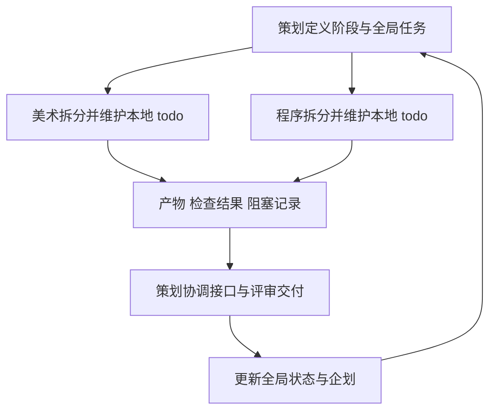

# 全局工作清单

| 字段 | 内容 |
| --- | --- |
| 文档ID | project.todo |
| 类型／负责人 | 全局任务／策划 |
| 用途／读者 | 项目治理与协调／策划、程序、美术 |
| 维护方式 | 持续维护 |
| 生命周期／修订／更新 | 当前／1.16／2026-10-22 |
| 适用范围 | 阶段、优先级、跨角色交付唯一入口 |
| 依据／关联 | 用户三角色分工与后续指令；角色todo维护内部步骤 |

维护角色：策划。更新日期：2026-10-22。

本文件是项目阶段、全局优先级、跨角色依赖和交付验收的唯一入口。策划在本文件维护自己的任务及交付包；美术、程序各自拆分与维护本地任务，策划汇总交付包状态，不重复维护其内部步骤。

| 角色 | 工作清单 | 主要责任 |
| --- | --- | --- |
| 策划 | 本文件 | 定义体验、规则、阶段、范围、优先级与跨角色验收，协调阻塞 |
| 美术 | [美术 todo](docs/art/todo.md) | 风格与资产设计、素材制作、自检、源文件及交付物 |
| 程序 | [程序 todo](docs/tech/todo.md) | 技术选型、架构与接口、实现、集成、运行验证 |

## 当前阶段：M1 单场地波次战斗

**用户于2026-10-18要求降低第一里程碑复杂度：在一个完整场地内击退几波敌人即可。**当前唯一范围入口是[原型范围v0.4](docs/design/prototype-scope.md)，决定见[ADR-013](docs/decisions/ADR-013-first-milestone-wave-defense.md)。策划建议三波、锋刃／铁砧两种既有主武器、一种近战小兵、波间自动整备、胜负与重开；这些数量／数值尚待试玩，不写作用户逐项确认。本轮CS-050已统一推荐规则：无限备弹保留换弹、每批N+1、所有波次清波优先、自救每局一次；程序实现／验收按[修正交接](docs/production/m1-rule-fixes-handoff.md)，当前未代报完成。

旧“目标→Perk→转点→支援→撤离”、三敌种齐备、Boss／明珠激光、全上海布局和建筑破坏专项移至后续里程碑，不作为M1门槛。已经交付的实现、素材和测试记录全部保留，不撤销历史授权、不删除旧模式。此前P0／P1a／P1b批次作为研发记录保留，不再按旧全量闭环推进第一里程碑。

保留Godot、桌面双平台、键鼠／手柄、1～4人LAN、无分屏、加入／重连、友伤默认关闭、城市远景与独立任务边界等原则。复用已有场地与框架；只要求其中一个连续战斗区域通路、边界、遮挡、入场与战斗可用，不要求全城正式资产完成。不以60米沙盒或独立200米测试场替代主场地验收。

**地图最新输入（2026-10-20）：**用户明确陆家嘴承载M1；美术已按获认可的约2.4×2.0公里方向交2399×2004米母版，不能再要求缩回500米。按[ADR-015](docs/decisions/ADR-015-lujiazui-map-and-combat-area.md)分开整图与单局活动域，建议CBD约100～140米连续街块先接入，具体点位待评审。重复游玩分固定基线→人工来敌脚本→多局部战场→后续兵种，不自动扩大M1。

**本轮执行输入：**用户已选三塔CBD。[CBD场地布局](docs/design/m1-cbd-battlefield.md)、[角色交接单](docs/production/m1-cbd-handoff.md)、[ADR-016](docs/decisions/ADR-016-m1-cbd-battlefield.md)定义O／P、遮挡、三门和三波。程序已交[v005同版CBD候选](docs/tech/m1-cbd-integration.md)及[美术空间包](docs/art/environment/m1-cbd-layout.md)，不再写为仅有绿地／未迁移；空间偏差、正式边界与玩法仍分别验收。角色化快移动和城市刷新见[讨论稿](docs/design/city-traversal-and-encounters.md)，不自动成为M1前置。

### M1退出条件

1. 单人能在同一场地完整打完建议三波，最后清波直接胜利；失败可重开，敌人／计时／奖励无残留。
2. 角色、敌人、枪击、危险和场地边界可辨认，敌人有限刷出且不贴脸、不穿墙、不残留不可达敌人卡关。
3. 波间自动整备；无需操作终端、抽Perk或呼叫支援，正常弹匣与换弹依旧有效。
4. 两机LAN的敌人计数、伤害、救援、波次与胜负一致；加入／重连不刷资源。真实设备、四人、新手与性能分别记录证据，不能用同机多进程替代。
5. 新手能参与射击与走位，熟练玩家有转火和救援空间；正式资产、全六角色／八怪、全量后坐与散布细则不自动成为此里程碑前置。

### 后续安排

先把单场地波次战斗打顺，再依据试玩决定是否接C／E、Perk或一个支援；完整任务、撤离、Boss与上海地标事件继续保留为后续设计，不同时拉回M1。

### M1当前执行看板（2026-10-20核对）

**当前结论：已有v005同版CBD及角色候选交付，用户试玩报告钳牙威胁低／卡小物；空间与玩法退回、规则矩阵及设备验证仍待关闭，M1未完成。**下表按交付结果归组，沿用既有CS编号；具体参数仍只在设计源维护，完整任务与历史见下方总表。状态来自角色当前入口与交付记录，本轮未重跑游戏。

| 顺序／交付结果 | 责任／任务 | 已有证据与剩余工作 | 关闭条件／依赖 |
| --- | --- | --- | --- |
| 1．CBD空场走通 | 美术CS-028／033；程序CS-034；策划CS-035评审偏差 | [v005同版空间包](docs/art/environment/m1-cbd-layout.md)与[CBD程序候选](docs/tech/m1-cbd-integration.md)已交，已有路径／同机证据；空间偏差待评审，本轮小物卡路反馈沿CS-065复现修复；旧自由跑图仍保留v002 | 按[CBD交接](docs/production/m1-cbd-handoff.md)交同版地图身份、实际点位／偏差、玩家环路与H→E实走；不能以整图鸟瞰或绿地三波关闭 |
| 2．两枪与近战A可打、动作／命中可读 | 美术CS-030；程序CS-031／052；策划CS-005／026 | 锋刃＋配套步枪v002、钳牙v001已有接入；分区命中已有专项证据。铁砧机枪沿用现有配置，不要求新人物模型；DEV-066换弹衔接退回仍待美术适配 | 复用[人物接口](docs/tech/character-animation-handoff-v1.md)与[两项动作退回](docs/qa/2026-10-20-layered-animation-validation.md#退回美术适配的具体问题)，交修正版／回接证据；在CBD检查移动、射击、换弹、攻击预警及身体／双钳命中。新角色／整套新武器不前置 |
| 3．三波、资源与恢复规则一致 | 程序CS-029／051／052；CBD发兵归CS-034 | 旧三波模式已交；[本轮修正](docs/production/m1-rule-fixes-handoff.md)S／W／G案例尚无完整关闭证据。并行代码或旧报告不等于本单已通过 | 提交有效配置差异／哈希与逐例结果；正常资源下三波、故意失败、重开、跨波自救及加入／重连可复测。场地验收依赖1，状态反例可先做 |
| 4．HUD能指导当前操作 | 策划CS-021；程序CS-052；美术已有ART-062输入 | [HUD规则](docs/design/m1-hud-flow.md)已交，旧功能HUD已实现；[美术v0.5素材](docs/art/ui-m1-kit-v01.md)仅独立交付，未接Godot | 按U01／02验波次／待刷计数、匣／∞、房主权限、倒地／自救资格与胜负。先保证规则可读；素材接入单独登记，不把示意拼图当运行证据 |
| 5．接近显现边界可用 | 美术CS-047；程序CS-048 | ADR-021方案已确认；当前未见该交接的完整资产／运行验收记录，可先用临时网格联调 | 按[边界交接](docs/production/m1-cbd-handoff.md#cs-047048-已确认任务边界交付)验提前可读、沿边滑动、转角／冲刺、射击相机、来敌与边缘救援；与1共用同版活动域 |
| 6．同版交付与分层试玩 | 程序CS-029／034／052交候选版和技术证据；策划CS-022组织／记录，CS-003收敛性能门槛；美术复核可读性 | [当前采用](docs/tech/current-build.md)是源码身份；旧ZIP不含全部后续功能。CBD单人、真实两机、新手混队、四人及目标设备证据仍待齐 | 汇总1～5的采用版本及未关闭问题，再按[试玩计划](docs/production/m1-playtest-plan.md)S1→S2→S3→S4执行。Windows／macOS、物理手柄、性能和用户确认分别留证；性能门槛未定前不宣称达标 |

推进关系：**1先走通空间；2～5可按各自输入并行准备，随后在同一CBD版本集成；6逐层验收，失败退回对应任务。**“并行”指仓库任务依赖，不自动启动其他会话或Agent。

本轮策划先做三件事：收取并评审CBD同版点位／偏差；把DEV-066退回纳入CS-030／031；在试玩前补齐CS-003的设备配置、分辨率与性能通过值。三波参数与时长沿现有提案测试，不重新逐项等用户拍板；性能通过值仍待讨论，不能代填成已确认。

暂不进入M1关键路径：全六角色／八怪、拾取枪与Q3火箭／大师剑、Perk／支援／撤离、载具／大图完整流程、Boss／明珠激光、全城破坏和非必要装饰升级。文档治理CS-055～057已有静态验收；工具遗留CS-058／059也不阻塞M1。已有用户授权的独立工作保留。

美术／程序已交CBD v005候选，CS-033／034按现有证据评审；用户首轮压力／卡物反馈由CS-064～066接续，参数候选见[钳牙威胁调整](docs/design/m1-qianya-pressure.md)。另开开发工具包CS-060～063：[紧凑实验室](docs/design/test-ground.md)、[两枪＋钳牙矩阵](docs/design/m1-combat-test-matrix.md)与[重构交接](docs/production/test-ground-refactor-handoff.md)。策划设计可先交，程序基本几何可先用，美术表现不前置；完整旧机制展览不成为CBD或M1新增门槛。

### CS-065 钳牙增强试验

责任：程序；试验制作已获用户授权，领取／交付状态见任务表。唯一规则输入为[钳牙威胁调整](docs/design/m1-qianya-pressure.md)，验收按[CBD补充交接P01～P06](docs/production/m1-cbd-handoff.md#钳牙威胁试玩退回cs-065)。

范围与顺序：保留Q0原版，依次交Q1通路修复、Q2追速、Q3出手与Q4密度对照；实验室重构不前置。各阶段配置、保护条件与回退规则在设计源维护，不以穿模、缩模型／受击体、贴脸生成或静默删怪解决问题。

交付：逐例结果、障碍ID／追逐轨迹、有效配置差异／哈希、接敌／攻击记录、Q4可操作入口及Q0～Q3对照；当前采用／操作说明与真实LAN、设备性能、真人体验未测项同步。试验授权不等于参数定版或体验验收。

### CS-061062 测试场重构

责任：程序CS-061、美术CS-062；执行顺序为先完成各自当前已领取工作并同步交付／检查记录，再接本包。输入为[紧凑实验室](docs/design/test-ground.md)、[两枪＋钳牙矩阵](docs/design/m1-combat-test-matrix.md)及[重构交接](docs/production/test-ground-refactor-handoff.md)。

交付：程序按近距A批→长射道／视觉观察／联机恢复B批推进；美术复用现有素材交地面、标线、遮挡与观察背景。采用入口、配置／素材身份、T00～T12及R01～R08分批证据与未测项纳入验收，策划沿CS-063接续。

依赖与边界：基本几何可先行，美术不等待程序最终功能；技术上可独立不改变上述工作顺序。复用战斗／网络／素材接口，保留旧模式与其他会话WIP，不追加付费生成或新玩法；角色领取、交付与通过分别登记。

### CS-076 全员角色视觉设定

| 项目 | 定义 |
| --- | --- |
| 责任与顺序 | 美术；当前P0／已领取M1工作优先，随后接续本包；内部ART任务由美术拆分 |
| 唯一人物输入 | [人物设定修订1.11](docs/design/characters.md)，含[建模体型](docs/design/characters.md#body-scale)、[四维速览](docs/design/characters.md#overview)与H1～H16完整档案；人物文字／尺寸不另建副本 |
| 风格依据 | [Art Bible](docs/art/style-guide.md)与[六人已认可主形](docs/art/student-combat-forms.md)；后续用户明确指令优先于旧命名／体型描述 |
| 适用范围 | 16名角色的视觉设定；既有六人沿已认可身份／装置主形细化，新十人作候选探索，不代表正式阵容批准 |

交付与验收：

1. 全员体型对照：同地面、同视角、按身高比例排布的无装备人体灰度／剪影，以及持招牌装备的同框对照。标稳定ID与当前名，尺寸标签引用人物源；身体的高矮、胖瘦、肩腰和四肢差别可见，不能靠换色或放大装备替代。
2. 代表角色先行：发条大熊、星轨、铁砧、游隼先行细化，分别检验壮硕、小只、矮圆、高挑与不同气质，再沿统一风格扩展其余角色；新增意象融入既有六人主形。
3. 单人设定：每人包含正／侧／背视、一个代表战斗姿态、两种表情或性格反差小稿；标清人体与装备连接／穿戴关系及需分离的武器／装置。主题呼应名字，姿态与表情表达具体性格，不以同脸、同站姿或文字标签替代。
4. 辨识与一致性：隐藏姓名／配色比较主轮廓，再看性格小稿；相似角色能靠身体、装备关系和动作分开。二维标注／透视偏差需说明，设定图不冒充精确模型尺寸或玩法实现；涉及技能／资源／机制冲突时，在美术todo按稳定ID记录，由策划协调。
5. 制作记录：设定图、源文件／提示词和实际检查证据由美术在本辖区维护，并更新人物分类、画廊和本地todo。CS-068继续负责事实／引用对齐；领取、交图、用户认可与后续建模分别登记。

范围边界：本包不含3D生成、建模、绑定、动画或程序接入，不改现有运行资产、不扩M1；额外付费生成沿既有授权。概念稿供用户审美评审，接续制作不等于逐项外形／尺寸已确认。

## 全局任务

状态：待领取、进行中、待评审、阻塞、完成、暂缓。完成必须有可检查产物；文档完成不等于用户确认或实机通过。优先级从高到低为 P0、P1、P2，与阶段编号是不同概念。

| ID | 优先级 | 负责人 | 任务与验收要求 | 依赖 | 状态 |
| --- | --- | --- | --- | --- | --- |
| CS-001 | P0 | 策划 | 保存调研、讨论、企划与目录约定；所有入口可访问 | 无 | 完成：[README](README.md) |
| CS-002 | P0 | 策划 | 建立三角色协作、阶段与工作清单 | CS-001 | 完成：本文件及两份角色清单 |
| CS-003 | P0 | 策划 | 收敛目标年龄、设备、首发平台、组队与性能验收门槛；在决策清单记录确认或临时假设 | 用户讨论 | 待评审：已同步 [ADR-002](docs/decisions/ADR-002-desktop-lan-scope.md)；平台／组队已定，不再重问；年龄解释与机器详配待补。性能验收前需记录分辨率／画质、帧率／帧时间和连续运行时长门槛，尚未确定 |
| CS-004 | P0 | 策划 | 定义首个可玩原型的范围、非目标、场景和验收问题；产出 `docs/design/prototype-scope.md` | CS-003 的确认或明确假设 | 已按新M1完成范围收敛：[单场地波次战斗v0.4](docs/design/prototype-scope.md)；三波参数为提案，待玩法验收 |
| CS-005 | P0 | 策划 | 展开移动、步枪、敌人组合、救援、难度与友伤规则；产出 `docs/design/combat.md`，区分提案和确认 | CS-004 | 待评审：[战斗草案](docs/design/combat.md)与[怪物详细设定](docs/design/enemies.md)已交；具体参数未实测 |
| CS-006 | P1 | 策划 | 先交原型任务、Perk、支援、撤离与加入恢复流程；完整产品扩展后续拆分 | CS-004 | M1移出／延后；既有产物和状态保留：待评审：[短闭环流程](docs/design/prototype-loop.md)已交；数值与边界待双边评审 |
| CS-007 | P0 | 美术 | Art Bible v0.1、首轮概念与最小资产设计；按 [视觉任务书](docs/archive/art/2026/concept-brief-v01.md) 先交视觉子包；由美术在 [本地任务](docs/art/todo.md) 拆分 | 视觉子包可立即开始，不等 CS-004；最终原型资产清单依赖 CS-004 | 进行中：整体风格方向已获认可；ART-032／033角色T Pose与敌人三视待评审，旧直接建模路线暂停，正式资产及接入未通过，见本地清单 |
| CS-008 | P0 | 程序 | 预研包与最新范围对齐，后续框架实现按 ADR-004 及本地清单跟踪 | 平台、原型与接口 | 待评审：已有预研及[框架验证](docs/archive/qa/2026/framework-validation-v01.md)；本机通过不等于两机 LAN 或短闭环通过 |
| CS-009 | P1 | 策划协调，美术和程序共同提供输入 | 收敛美术程序接口；对应角色文档相互引用，明确版本、待验项和责任 | CS-005、CS-007、CS-008 | 已确认：[ADR-014 角色资产接入接口](docs/decisions/ADR-014-character-asset-interface.md)经用户 2026-10-19 确认（D-020）；执行见 CS-030／031 |
| CS-010 | P1 | 策划 | 评审当前产出，收敛P1验收范围、依赖与批次；保留ADR-004／006已有实现授权，不重复索取 | CS-004 至 CS-009 | 已完成本轮范围与批次收敛：[ADR-013](docs/decisions/ADR-013-first-milestone-wave-defense.md)及新M1；不代表运行验收 |
| CS-011 | P0 | 策划 | 补齐美术启动任务书，明确视觉探索范围、交付、评审与未决输入 | 用户同意启动 Art Bible 与概念设计 | 完成：[任务书](docs/archive/art/2026/concept-brief-v01.md) |
| CS-012 | P0 | 策划 | 补齐程序并行预研范围、分批交付和美术接口，避免等待视觉定稿 | 当前 P0 与用户并行工作讨论 | 完成：程序启动任务书 |
| CS-013 | P0 | 策划 | 细化已确认 500×500 米首图的坐标、路线、边界、元素、入口与战斗节奏 | ADR-005、当前移动参数和户外破坏约定 | 完成文档交付：[第一场景 v0.2](docs/archive/design/2026/first-scene.md)；布局细节待灰盒评审，非场景完成 |
| CS-014 | P1 | 美术 | 首图场景布局／模块清单、边缘与远景表现，先代表街口再扩模块；按 [交付任务书](docs/archive/production/2026/first-scene-handoff.md) 自行拆分本地 ART 任务 | CS-013；现有角色制作可继续，正式接入依赖样件接口 | M1移出／延后；既有产物和状态保留：待领取：本轮仅下达工作定义，不代替美术报进度 |
| CS-015 | P1 | 程序 | 500米独立灰盒、任务边界、区域／入口／落点，分批接入短闭环与单楼恢复；见 [交付任务书](docs/archive/production/2026/first-scene-handoff.md) | CS-013；已有框架可先开始，不等全套美术；后续实现沿用已有授权范围 | M1移出／延后；既有产物和状态保留：进行中：程序DEV-015已交[500米功能灰盒](docs/archive/tech/2026/short-loop.md)与[验证边界](docs/archive/qa/2026/short-loop-validation-v01.md)，侧路／入口／三敌种／自然节奏和联合验收仍未完成 |
| CS-016 | P1 | 策划协调，美术程序共同提交 | 首图尺度、相机、边界、战斗与破坏的分层评审，记录接入和两机结果 | CS-014／015 的首批产物即可评审，不必等两包全部完成 | M1移出／延后；既有产物和状态保留：待领取：检查点与证据要求见交付任务书 |
| CS-017 | P0 | 策划 | 参考八张当前怪物图，定义全名单的尺寸、HP、机动、攻击、战场职责、组合与美术程序接口 | 当前美术名单、CS-005、CS-013 | 完成文字初稿、待评审：[怪物战斗设定 v0.3](docs/design/enemies.md)；包含空运变体，旧候选A／C／E；新M1仅近战。图源、链接与算术已检查；资产、引擎、多人和用户试玩未验 |
| CS-018 | P0 | 策划 | 收敛六角色攻击／伤害，计算对全部敌人TTK，编排大面积敌潮与独立Boss战 | 当前六人形态、CS-017、首图与武器基线 | 完成文字初稿、待评审：[武器](docs/design/weapons.md)、[TTK算术](docs/archive/design/2026/ttk-estimates.md)、[遭遇](docs/design/encounters.md)；可重建算术，未改玩法实现。旧候选H1／H3＋A／C／E，新M1敌人只要求近战，其余分批 |
| CS-019 | P0 | 策划 | 对照已交短闭环、实际配置与最新策划，形成已实现／差异／缺口／验收证据表；按影响排序，不把提案覆盖成实现 | DEV-012～016产物、CS-004～006／017／018 | 完成静态对照：CS-019评审；已核对源码／配置、v0.3与既有JSON证据，清理旧状态。未新跑Godot或替代真人／设备验收 |
| CS-020 | P1 | 策划 | 细化已有六种Perk的数值、适配、抽取与补选、叠加边界；对照程序实现并检查伤害阈值和冷却收益 | CS-006、CS-018、实际Perk配置 | M1移出／延后；既有产物和状态保留：完成规则初稿、待评审：[六卡规则](docs/design/perks.md)、[收益算术](docs/archive/design/2026/perk-estimates.md)；保留现有六ID与倍率，新增救援抗中断／支援冷却提案；未改玩法、未验平衡 |
| CS-021 | P0 | 策划 | 先交M1波数／敌人数、生命／弹药、倒地求助、波间计时与胜负提示；终端／信号／登机延后 | 当前闭环与共享输入；美术程序提供呈现约束 | 待评审：交[M1 HUD与波次提示](docs/design/m1-hud-flow.md)；文字与时长未试玩 |
| CS-022 | P0 | 策划 | 制定首轮试玩脚本、观察表、问题优先级及通过／回退条件；分单人、新手高手混队、两机与四人；区分体验与技术证据 | 当前原型范围即可先写；执行依赖可玩版本和实际参与者 | 待评审：已有[M1试玩计划](docs/production/m1-playtest-plan.md)，本轮补CBD点位／门点／显形检查；已有程序M1与绿地测试，CBD及真人／两机待验，策划未执行 |
| CS-023 | P0 | 策划 | 梳理可重复测试场的机制、便利控制、已实现／提案状态、接入批次与记录口径 | 当前武器／怪物／流程设计、程序短闭环与配置 | 完成需求交付；程序后续DEV-020～022已交[测试场v0.3](docs/archive/tech/2026/test-ground-v03.md)及[验证](docs/archive/qa/2026/test-ground-validation-v03.md)，现有机制第一／二批可操作，第三批与真实设备／用户验收未完成；本轮紧凑重构沿CS-060～063，旧v0.3不代验新设计 |
| CS-024 | P1 | 策划 | 定义上海陆家嘴场景身份、500米布局、Boss净空、地图交互及美术概念输入 | 用户选定陆家嘴、CS-013／018、ADR-005 | M1移出／延后；既有产物和状态保留：完成文字初稿、待评审：[上海概念v0.2](docs/archive/design/2026/shanghai-lujiazui.md)、[ADR-008](docs/decisions/ADR-008-shanghai-lujiazui-concept.md)；140米核心与180米外圈为提案，未改运行场景。CS-014概念参考新L版，CS-015保留旧灰盒待映射 |
| CS-025 | P1 | 策划 | 将用户提出的东方明珠激光转为终端方向代码输入、协作、充能、伤害、次数、射界与联机规则 | CS-024、G任务与用户新方向 | M1移出／延后；既有产物和状态保留：完成规则初稿、待评审：[明珠防卫光束](docs/design/oriental-pearl-laser.md)；上海概念v0.2及测试清单同步。50%开启／一次／25%伤害为提案，未实现 |
| CS-026 | P0 | 策划 | 细化六武器射速／散布／满伤与衰减／后坐力，敌人状态／攻击欲望／频率与博弈，并做阈值与走位算术核对 | 用户本轮数值讨论、CS-005／017／018 | 完成数值初稿、待评审：[基础方案](docs/archive/design/2026/combat-tuning.md)、[算术附表](docs/archive/design/2026/combat-tuning-estimates.md)；怪物v0.3／武器v0.2同步，未改运行配置或验收玩法 |

| CS-027 | P0 | 策划 | 按用户新要求收敛M1为单场地数波战斗，同步范围、流程入口、决策和交付优先级 | 用户2026-10-18范围修正 | 完成文档：[新M1范围](docs/design/prototype-scope.md)、[ADR-013](docs/decisions/ADR-013-first-milestone-wave-defense.md)；未改运行或做体验验收 |
| CS-028 | P0 | 美术 | 整理M1一个完整战斗场地：交火区、合法入口、遮挡、绕行、边界与已有角色／近战小兵可读性 | CS-027；优先复用已有场地／资产 | 进行中／交付待评审：[当前美术母版v005](docs/art/environment/lujiazui-city-v005.md)已交独立检查，运行仍采用v002；不能自动升级或把整图交付等同CBD完成。CBD同版空间与通路由CS-033接续 |
| CS-029 | P0 | 程序 | 复用框架组织有限波次、波间整备、清波判定、胜负重开、基础HUD与LAN同步 | CS-027；CS-028可分批接入 | 已交旧场地三波模式、待评审／试玩：程序DEV-035～037见[M1 v0.8](docs/tech/m1-waves-v08.md)；陆家嘴映射接入另按CS-034，不以旧100米方场代验新地图 |
| CS-030 | P0 | 美术 | 按[ADR-014](docs/decisions/ADR-014-character-asset-interface.md)交米制／−Z朝前／脚底原点的M1角色、映射／挂点和片段包；接续已有程序退回，修锋刃换弹起止与移动持枪衔接，不更换角色或武器范围 | CS-009；首包ART-043／044已交；退回输入为[DEV-066两项问题](docs/qa/2026-10-20-layered-animation-validation.md#退回美术适配的具体问题) | 首包已交、待整体验收：[角色包](docs/art/assets/m1-character-pack-v001.md)、[锋刃v002](docs/art/assets/fengren-grip-v002.md)。续交兼容原骨架／握点的动作及过渡、同条件预览与manifest；不得靠改权威换弹时间掩盖跳变。续修尚未代报ART领取；外部下载沿原授权约束 |
| CS-031 | P0 | 程序 | 接CS-030角色与配套武器、权威状态动画和挂点；钳牙保留尺寸、身体／双钳分区命中与导航包络分开。收到动作修正版后回接验证并更新运行manifest | CS-030；既有DEV-038～041／063～066 | 接入已交、待CBD／设备／试玩验收：[角色v0.9](docs/tech/character-integration-v09.md)、[命中v0.10](docs/tech/qianya-hitboxes-v10.md)、[分层验证](docs/qa/2026-10-20-layered-animation-validation.md)有引擎及同机证据；DEV-066衔接仍待美术适配，不再写未领取或要求旧球缩模。真实两机、Windows／物理手柄与用户动作验收未齐 |

| CS-032 | P0 | 策划 | 评审最新陆家嘴母版承载M1的空间与重玩方案，区分当前要求和后续建议 | 用户本轮要求、ART-047～050、DEV-035～041记录 | 文档已交、待评审：[地图评审](docs/archive/design/2026/lujiazui-combat-review.md)、[ADR-015](docs/decisions/ADR-015-lujiazui-map-and-combat-area.md)；已看静态图、核对文件，未运行／实走 |
| CS-033 | P0 | 美术 | 按用户选定CBD，依[布局](docs/design/m1-cbd-battlefield.md)灰摆P／K1～K3／R、3对H／E与活动域，交同版俯视／TPS视角／实际净口与点位差异表 | CS-035、CS-028现有总装 | 交付候选待评审：[v005同版空间包](docs/art/environment/m1-cbd-layout.md)，ART-071／072有静态／独立引擎证据；本轮卡物若需改源，接CS-065具体件清单沿本包协调，不代报玩法通过 |
| CS-034 | P0 | 程序 | 依[交接单](docs/production/m1-cbd-handoff.md)将现有陆家嘴接入迁移为CBD三波：同版坐标／地面／多边形活动域、掩体、H→E导航、有限调度、重开与恢复；本轮按[修正交接G01～05](docs/production/m1-rule-fixes-handoff.md)补域外隐藏H、四人守门、B=N+1与10秒配置异常暂停，旧H不可直接生成 | CS-035／033、DEV-042／043现有绿地接入 | 程序候选已交、待玩法／空间评审：[CBD接入](docs/tech/m1-cbd-integration.md)、[QA](docs/qa/2026-10-20-m1-cbd-validation.md)有v005引擎／同机证据；本轮用户反馈威胁不足／卡物沿CS-065修复，不以旧路径脚本关闭真人问题 |

| CS-035 | P0 | 策划 | 按用户选定三塔CBD细化局部坐标、遮挡、通路、3门与三波，并交接美术程序 | 用户本轮选择、CS-032、最新母版与DEV-042／043 | 已交设计、待评审：[CBD布局](docs/design/m1-cbd-battlefield.md)、[交接单](docs/production/m1-cbd-handoff.md)、[ADR-016](docs/decisions/ADR-016-m1-cbd-battlefield.md)；离线检查12点底图／坐标／时序，不是GLB／导航／运行验收 |
| CS-036 | P1 | 策划 | 按用户修正定义角色专属移动技能与跑图流程：路线／地形／沿途敌情／会合；比较固定主遭遇与有限视野外增援，区分M1与后续样段 | 用户本轮快速移动与刷新讨论、CS-032 | 讨论稿v0.2已交、待评审：[移动与城市跑图](docs/design/city-traversal-and-encounters.md)、[ADR-017](docs/decisions/ADR-017-city-traversal-direction.md)；用户明确原则，具体归属／数值未定；撤回统一巡航／默认传送，无实现派单 |

| CS-037 | P2 | 策划 | 保存后续载具／击杀积分呼叫／免费单车方向，提出与角色技能及跑图、队伍资源的关系 | 用户本轮未来机制建议、CS-036 | 方向稿已交、待评审：[载具与积分](docs/design/vehicles-and-tactical-points.md)、[ADR-018](docs/decisions/ADR-018-future-vehicles-and-points.md)；共享经济／数值／车型细则未定，不派发M1驾驶实现 |

| CS-038 | P2 | 策划 | 梳理大地图完整一局，将专属移动、跑图、沿途遭遇、前置与主战、积分／载具呼叫和撤离串联；检查零积分可走和消费分支 | 用户本轮要求、CS-036／037 | 后续方案已交、待评审：[完整流程](docs/design/large-map-run.md)、[节奏与经济算例](docs/design/large-map-run-examples.md)；阶段／积分／价格／时长均为提案，未改M1或角色任务／运行配置 |

| CS-039 | P1 | 策划 | 细化常驻无限弹药＋有限拾取武器分层，按射程／威力／射速／手感定位类型，检查强力预算与原弹药／Perk／整局设计冲突 | 用户本轮武器讨论、CS-018／026／038 | 已交设计、待评审：[武器系统](docs/design/weapons.md)、[算术例](docs/design/weapon-power-examples.md)、[ADR-019](docs/decisions/ADR-019-signature-and-pickup-weapons.md)；常驻无限备弹为最新方向，具体参数／槽位规则提案，运行／M1未改 |

| CS-040 | P1 | 策划 | 按户外广场／大怪重新量化全武器射程，分小／大目标有效带、满伤／衰减／上限，检查精度／弹速／投影／理想TTK与敌人反制 | 用户本轮修正、CS-026／039、最新260×220米核心与怪物表 | 量化设计已交、待评审：[射程方案](docs/design/weapons.md)、[统一附表](docs/design/weapon-range-estimates.md)、[ADR-020](docs/decisions/ADR-020-outdoor-weapon-distance.md)；未改game／assets／tools或M1；远距敌攻与真人可用性待验 |

| CS-041 | P1 | 策划 | 解释拳波／指令手枪和冲锋枪／机枪差别；核对Q3原始源码，记录用户新增火箭筒与挥砍＋剑气大师剑，明确与旧重火箭及M1边界 | 用户本轮方向、CS-039／040 | 文字方案已交、待评审：[武器辨析与新增](docs/design/weapons.md)、[Q3源码调研](docs/research/quake3-rocket-launcher.md)；后续需收敛角色归属／资源、火箭尺度与自伤。只做文档／算术检查，未派发美术程序制作或验证手感 |

| CS-042 | P1 | 策划 | 将常驻／候选／临时／Q3火箭与大师剑合为唯一武器设定文件，建立全局对比表、迁移射程及操控参数，修复引用 | 用户本轮文档整理要求、CS-018／026／039～041 | 已交文档、待评审：[武器设定总表](docs/design/weapons.md)；16种武器／18模式，旧三篇正文移除、算术保留独立附表；核对清单、参数与链接，不改代码／资产／角色todo或M1 |

| CS-043 | P1 | 策划 | 基于暂定武器收敛八类敌人攻击层次、时序／状态、防御／硬直、远距反制与多人压力；核对HP门槛及逃离预算，清理旧范围／有限主弹药冲突 | 用户本轮要求、CS-017／026／040／042 | 已交方案、待评审：[敌人v0.4](docs/design/enemies.md)、[数值与走位](docs/design/enemy-combat-estimates.md)；基础HP不变，C开壳×1.5及C／G射程、G横扫／D锁定为新候选。只做文档／算术，未改M1、代码／资产／角色todo；待用户讨论再排后续样件 |

| CS-044 | P1 | 策划 | 调研L4D、往日不再、暗潮与星际战士2的大量敌人战斗，区分开发者事实、设计推断与本项目借鉴；提出敌潮／场地／协作建议 | 用户本轮参考请求、CS-043 | 已交案头报告、待评审：[大量敌人战斗参考](docs/research/horde-combat-references.md)；核对Valve／Bend／Fatshark／Saber开发资料，保留来源与局限。未改敌人数值、M1脚本／代码／资产或美术程序任务；采纳项后续讨论 |

| CS-045 | P1 | 策划 | 将用户Witch式游荡强敌想法转为可绕行／可惊扰的偶发威胁方案，定义声画预警、惊扰归因、追击／扑击、多人救援与结束边界 | 用户本轮建议、CS-043／044、暂定武器 | 已交候选、待评审：[EN-H惊嚎兽](docs/design/enemy-h-jinghao.md)；720HP／40伤害／8.5m/s及概率／脱离为提案。核对Valve设计意图、纸面阈值与链接，未新增M1、代码／素材／角色任务，未声称手感／公平已通过 |

| CS-046 | P1 | 策划 | 细化接近显现半透明任务边界，比较替代方案；区分世界／M1／遭遇域，定义高速预告、沿边移动与射击／相机／入场／救援契约 | 用户本轮边界偏好、ADR-005／015、CS-035 | 设计整理完成；用户已确认采用：[ADR-021](docs/decisions/ADR-021-proximity-mission-boundary.md)、[规格v0.2](docs/design/mission-boundary.md)。执行拆至CS-047／048，参数调试及资产／运行／试玩未验 |

| CS-047 | P0 | 美术 | 按[交接单](docs/production/m1-cbd-handoff.md)交CBD地线／刻度、局部半透明网格和接触涟漪样式，含远近触边及明暗视角、来源登记／画廊；验收提前可读、能看清敌人／预警且不混淆敌方提示 | ADR-021、CS-033现有CBD样件 | 待领取：已写交付要求，未代报ART领取／制作／评审；允许先最小试样，不新增地图或付费素材 |
| CS-048 | P0 | 程序 | 按[交接单](docs/production/m1-cbd-handoff.md)接入CBD同域局部渐显与碰边滑动，预告随朝外速度、枪弹／相机分层；验证凸凹角／冲刺／敌人进场／救援及同版LAN，交参数与记录 | ADR-021、CS-034现有边界框架；可先临时网格并行CS-047 | 待领取：功能／单人／两机／用户试玩分别验，未代报DEV进度；不增加M1飞行／载具／瞬移 |

| CS-049 | P0 | 策划 | 审查M1范围／ADR／战场／战斗／交接／HUD／试玩及角色交付的一致性，区分历史、待迁移、静态缺陷与实测 | 当前仓库文档及相关只读代码 | 已交、待评审：[审查报告](docs/production/m1-consistency-review-v01.md)及[扫描清单](docs/production/m1-consistency-review-v01-inventory.md)，10项问题；四人发兵下界355秒经离线算术核对。未改规则／代码／资产，未运行复现或代报试玩通过 |
| CS-050 | P0 | 策划 | 按审查01／02／03／05／09／10统一M1入口、武器有效参数边界、人数节奏、资产判定条款、HUD条件与空等指标；同步索引和交接 | CS-049、ADR-013／014／015／016／021；涉及新取舍保持待评审 | 文档修正已交、待评审：[修正交接](docs/production/m1-rule-fixes-handoff.md)、原型v0.4／CBD v0.2／武器§9／HUD／试玩／ADR-014及入口已同步；[人数算术](docs/design/m1-wave-timing-estimates.md)已核对；本地Markdown链接、设计行数／围栏、任务编号与diff空白检查通过。推荐细则非用户逐项确认，程序及真人验证未完成；程序角色入口已在CS-056整理同步；玩法修复仍按独立证据验收 |
| CS-051 | P0 | 程序 | 按[修正交接S01～09](docs/production/m1-rule-fixes-handoff.md)复核／修正跨波自救消耗、所有波次清波优先、完整权威步裁决、无人行动停刷及恢复重预告、重连奖励去重；交逐例日志／测试与回归证据 | CS-049／050已交推荐口径；CBD刷点继续归CS-034，边界归CS-048 | 待领取：导演仅记录需求，未代报DEV进度。验跨波／重连／合作转单人与终局；单人、本机多进程和真实LAN分别记录，不增加玩法范围 |

| CS-052 | P0 | 程序 | 按[修正交接W01～05／U01～02](docs/production/m1-rule-fixes-handoff.md)接M1无限备弹保留换弹、武器§9采用边界及HUD资格／权限／终局提示；提交有效配置逐字段差异／哈希、旧有限模式回归，交付入口跟随本次实际采用版本 | CS-050；数值仅采用武器源头，不追加全武器手感或新副手 | 玩法修正待角色接续／验收：文档输入已齐，入口历史分层已在CS-056完成；未代报DEV接入或玩法通过。当前包不视为新规则已实现；单人／同机／真实两机分别记录 |

| CS-053 | P1 | 策划 | 提出全局文档导航、分类总表、命名／结构／权威来源、归档与维护规范 | 用户文档治理要求、现有入口 | 用户已明确采用；正式规范见[documentation-standard](docs/production/documentation-standard.md)，原提案归档。落地分CS-054／055／056；不代表所有玩法参数获确认 |

| CS-054 | P1 | 策划 | 落地AGENTS／目录／文档规范、总导航／设计分类与模板；整理策划当前源、拆长表、归档过时内容并修引用，交处置映射与检查 | CS-053已采用；保留其他角色WIP与有效授权 | 已交、待评审：[总导航](docs/README.md)、[分类索引](docs/design/README.md)、[整理报告](docs/production/2026-10-20-documentation-migration-review.md)。10份归档、6个临时兼容页；当前源可达性、元信息／编号、设计行数／围栏、MD／图片链接、归档原文和diff检查通过，详见报告；ADR-022／D-022登记采用，不代报运行／角色整理完成 |
| CS-055 | P1 | 美术 | 按[整理交接](docs/production/documentation-handoff.md)重整美术入口／分类视图／画廊与当前资产元信息，manifest保留唯一源；归档旧稿，迁旧上海／场景交接引用，交映射／指纹／依赖与未完成项 | CS-054规范／模板；自己的源资产与授权保留，整理不阻塞既有M1制作 | 完成（文档静态验收通过），待用户评审：[美术报告](docs/art/2026-10-20-documentation-review.md)、[导演验收](docs/production/evidence/2026-10-20-documentation-acceptance-review.md)。D01～07静态范围通过，15份完整归档／53份详情骨架已核对；发布器重生未测，ART-070转CS-058；不代验外观／运行 |
| CS-056 | P1 | 程序 | 按[整理交接](docs/production/documentation-handoff.md)补components总表、入口／QA／当前构建唯一指向及组件模板；迁旧设计入链与tools旧生成说明，整理tech／qa历史，交映射／依赖／检查 | CS-054；既有代码、QA原始证据与资产接入保留，CS-051／052玩法实现仍单独验收 | 完成（文档静态验收通过），待用户评审：[程序报告](docs/tech/2026-10-20-documentation-review.md)、[组件总表](docs/tech/components.md)、[导演验收](docs/production/evidence/2026-10-20-documentation-acceptance-review.md)。17份完整＋1段归档，106项源码输入匹配；5份历史清单／固定输出保留DEV-070→CS-059，CS-051／052未代报 |

| CS-057 | P1 | 策划 | 按D01～07复核CS-055／056、汇总总导航／归档与全局状态，迁入链后清理已解除依赖短跳转，保留证据／有效工具输入 | 两角色报告、源快照／归档记录、用户本轮清理授权 | 完成（静态交付）、待评审：[导演验收](docs/production/evidence/2026-10-20-documentation-acceptance-review.md)、[复核证据](docs/production/evidence/documentation-acceptance-evidence.md)。迁32处链接，清23短页；321份MD／193份当前文档的目标、锚点、元信息、ID与导航等检查通过；程序／美术正文未接管，代码／资产／运行验收未变 |
| CS-058 | P2 | 美术 | 承接ART-070，后续分离旧资产生成与文档发布，适配元信息／唯一索引／幂等更新并独立验证重生；保留实际固定输入 | [工具说明](docs/art/documentation-tooling.md)、CS-055静态发现 | 待排期：不是本轮文档验收前置；未执行旧发布器，不擅自重生覆盖入口／台账或追加素材生产，具体ART步骤由美术维护 |
| CS-059 | P2 | 程序 | 承接DEV-070尚余工具部分，后续隔离固定QA输出／副输出，评估5份字节绑定旧清单的版本迁移与历史包比对；保留原始证据 | CS-056依赖记录、[程序报告遗留](docs/tech/2026-10-20-documentation-review.md#遗留与导演汇总) | 待排期：短跳转依赖本轮已清；管线输入／输出迁移未做，不作为本轮文档验收前置，不因补格式破坏旧包字节比对；DEV内部任务程序维护 |

| CS-060 | P0 | 策划 | 整理两枪＋钳牙测试矩阵、技术／体验验收与紧凑实验室设计，核对数值和现有差异，同步索引与归档 | 用户本轮要求；既有测试场与武器§9 | 文档已交、待评审：[设计](docs/design/test-ground.md)、[T00～12](docs/design/m1-combat-test-matrix.md)、[算术](docs/design/m1-combat-test-estimates.md)、[检查](docs/production/2026-10-20-test-ground-design-review.md)；无新场景运行／真人验收 |
| CS-061 | P1 | 程序 | 按[重构交接](docs/production/test-ground-refactor-handoff.md)分A／B批交单核心／长射道、快捷预设与快速复位、标准靶／真实钳牙、可信测量及视觉观察；复用战斗／网络并留旧模式回归 | CS-060；先完成当前已领取工作；M1目标字段复用CS-052；技术上A批不依赖CBD完整验收或最终美术 | 已安排后续、待当前工作完成后领取：按上方正式任务范围与交接分批推进；交采用入口／配置与素材身份、T／R逐例证据；未代报DEV领取或运行通过 |
| CS-062 | P1 | 美术 | 按[重构交接](docs/production/test-ground-refactor-handoff.md)复用地面／标线／遮挡样件与正常／阴影观察背景，给人物／钳牙／武器同框预览和尺寸／碰撞建议 | CS-060；先完成当前已领取工作；之后可独立于程序最终功能准备，既有资产优先 | 已安排后续、待当前工作完成后领取：源／导出／manifest／独立检查与画廊由美术维护；无新增付费生成，基本几何不等此包，未代报ART领取 |
| CS-063 | P1 | 策划 | 按矩阵执行两枪＋钳牙首轮近距／小群体验，区分技术失败／视觉与手感，保留原话并提出单组变量A-B调参；B批接续远距／合作 | CS-061可运行A批及明确基线；真人／设备条件按实际登记 | 待执行：[矩阵](docs/design/m1-combat-test-matrix.md)；设计与离线TTK不代替实测，不自动把测试场体验通过写作CBD／M1完成 |

| CS-064 | P0 | 策划 | 记录CBD v005用户试玩威胁低／卡物／数量不足反馈，核对当前配置／行为／路径证据，交分步修复与调参及验收 | 用户本轮反馈及入口确认；当前角色交付 | 文档已交、待评审：[Q0～Q4方案](docs/design/m1-qianya-pressure.md)、[P01～06交接](docs/production/m1-cbd-handoff.md#钳牙威胁试玩退回cs-065)；新速度／节奏／密度为待测候选，不代报已采用 |
| CS-065 | P0 | 程序 | 按[CBD补充交接](docs/production/m1-cbd-handoff.md#钳牙威胁试玩退回cs-065)先复现并修小物／窄口队列／追逐停滞，再分Q2追速、Q3攻击、Q4密度交对照；记录真实接敌与可交战量，保留原版回归 | CS-064；用户2026-10-21已同意按方案试一版；当前CBD同版实现／地图，实验室重构不前置；源资产问题沿CS-033协调 | 已获试验制作授权、待程序领取：按上方试验范围做Q0～Q4对照，提交P01～06证据与Q4试玩入口；尚未代报DEV领取／实现／验收，试验参数未正式定版 |
| CS-066 | P1 | 策划 | 在程序同版修复候选上复测两枪追逐／小群／CBD三波，区分卡路恢复、接近／出手与密度收益，记录原话与回退结果 | CS-065逐步可玩候选；可用现有场景或专用脚本，不等CS-061整包 | 待执行：[对照标准](docs/design/m1-qianya-pressure.md#5-验收与回退)，不把用户一次反馈当全部S1记录或新方案已验收；与CS-063实验室测试互引 |

| CS-067 | P1 | 策划 | 对照武器源审查既有六人身份／主形／攻击与移动，按剩余十类武器补人物文字；保持原武器资源层次和M1范围，交映射／差异／待决 | 用户2026-10-21本轮角色设计要求；武器暂用基线与六人美术源 | 文档已交、待用户评审：[角色总表](docs/design/characters.md)、[审查](docs/production/evidence/2026-10-21-character-weapon-review.md)、[十人文字](docs/design/characters.md#h7)；原六人ID保留，新H7～16仅候选，不代报实装／新图／模型或平衡通过 |
| CS-068 | P1 | 美术 | 以[人物唯一源](docs/design/characters.md)和[攻击规则](docs/design/characters/attack-rules.md)对齐旧角色引用，人物正文不另抄维护；只在美术领域保留视觉制作／资产差异与证据 | CS-067／071～075；角色称呼在本辖区正文统一；尺寸输入读[建模体型表](docs/design/characters.md#body-scale)，名称、具象意象与性格输入读[人物唯一源](docs/design/characters.md#naming)，主形和既有确认保留，新增细节待评审；新十人未确认 | 待角色接续：引用／事实对齐并登记后续制作尺寸输入；日后建模交同地面人体／装配对照与尺寸偏差，不在本包开图／生成／建模或重构玩法；视觉设定制作另按CS-076；文字集中不等于新增演出／资产已完成，未代报ART领取 |
| CS-069 | P1 | 策划 | 以选目标、出手、持续操作和失败代价审查全部角色攻击，补星轨区别普通枪的完整机制提案及铁砧覆盖／集火方向，列重叠武器与可观察验收 | 用户2026-10-21要求各角色攻击有特点；唯一提案输入为[攻击辨识度](docs/production/evidence/2026-10-21-attack-identities-review.md)及其星轨详情；当前武器基线仍有效 | 审查文档已交；后续六人方向经用户认可，当前规则由CS-071承接，早期扇面等仅备选回溯。未制作样机或宣称体验通过 |
| CS-070 | P1 | 策划 | 保留一人一把招牌武器，展开六人主要攻击玩法与十类扩展，写普通攻击／变化触发／代价、候选优先级与可观察验收 | 用户要求在单武器内探索蓄力、连续变形、节奏暴击、爆炸及无人机任务分配；唯一创意源为[单武器多变化](docs/design/characters/attack-variants.md) | 概念文档已交；用户认可六人主案方向，见[ADR-024](docs/decisions/ADR-024-six-character-attack-mechanics.md)，具体细化与源文同步沿CS-071。十类扩展未采用，未派制作或改变M1配置 |
| CS-071 | P1 | 策划 | 将已认可的六人单武器方向细化为操作／触发／状态／资源与取消规则，同步角色和武器；核对16类武器文字覆盖、处理旧规则和算术边界 | 用户2026-10-21直接要求；[ADR-024](docs/decisions/ADR-024-six-character-attack-mechanics.md)；当前输入为[共用规则与六单项](docs/design/characters/attack-rules.md) | 文档已交：[角色](docs/design/characters.md)、[武器v0.5](docs/design/weapons.md)、[交付与离线检查](docs/production/evidence/2026-10-21-six-character-attack-review.md)。六人方向认可，具体初值待验；32文档619处本地链接／锚点、ID／行数／索引可达、71个CS编号与归档指纹检查通过，六项离线预算已核对；16类都有文字对应，通用／临时代表不改独占；M1保留普通两枪，无新代码／美术或体验验收 |
| CS-072 | P1 | 策划 | 完善所有16名角色／候选的独特外形、性格行为／缺点、战场作用、操作手感与代价，补原临时武器代表的常态招牌候选并做撞型检查 | 用户2026-10-21全员设定要求；当前[角色总表](docs/design/characters.md)、六人既有主形／攻击与十人文字 | 人物文字已交、待评审；后续CS-073已集中至[角色设定唯一源](docs/design/characters.md)，[原交付审查与迁移记录](docs/production/evidence/2026-10-21-character-roster-review.md)保留前轮12文档／399链接等原时点证据。候选／正式阵容边界、M1和通用临时政策不变 |
| CS-073 | P1 | 策划 | 按用户要求把所有角色设定集中在一个文件维护，完整合入16人正文、四维对照与招牌候选，移除四份重复源并修复当前／历史入链 | 用户2026-10-21明确单文件要求；唯一源[docs/design/characters.md](docs/design/characters.md)；武器参数仍归武器规则 | 已合并16个完整人物条目，四份原源在逐条迁入后移除；[迁移与原文指纹](docs/production/evidence/2026-10-21-character-roster-review.md#5-后续集中维护cs-073)已登记，原武器归档只修人物链接。未改人物内容、武器参数、代码或资产；12文档470处链接／锚点、16人字段／页内锚点、73个CS编号与当前归档指纹通过，旧文件链接为0；357行按用户单文件要求保留 |
| CS-074 | P1 | 策划 | 替换生僻候选名，混合二／三／四字称呼；为全员补具象主题、第一印象与性格反差，使萌／酷／傲娇／元气／可靠／搞笑等吸引力有具体行为 | 用户2026-10-21命名、具象形象与阵容偏好要求；唯一输入／交付均为[人物设定](docs/design/characters.md#naming)，稳定H1～H16与既有六人主形／攻击保留 | 文字修订已交、具体名字／新外形待用户评审；当前引用同步武器及探索页，历史文档称呼随后由CS-075统一；9文档362处本地链接／锚点、16人八类字段／稳定ID、二三四字长度分布、74个CS编号及作用域diff检查通过，武器数值未改。美术经CS-068引用接续，本包不启动出图／建模／程序实现；M1范围不变 |
| CS-075 | P1 | 策划 | 移除人物名称变更对照，历史文档角色称呼统一；为16人明确身高、体重、身体肩宽和可建模体态，拉开壮硕／小只／圆润／修长差异 | 用户2026-10-21明确要求；唯一输入／交付[人物设定与建模体型](docs/design/characters.md#body-scale)，锋刃沿ADR-014已有185 cm基准 | 人物文字已交；历史审查称呼统一、原机制结论与证据时点保留；7文档343处本地链接／锚点、16套尺寸与档案引用、75个CS编号、归档指纹及diff／空白检查通过，全仓Markdown九个已替换人物称呼残留为0。美术经CS-068读取尺寸与后续测量要求；本包未建模、未改代码／碰撞，不扩M1或批准十人接入 |
| CS-076 | P1 | 美术 | 按[视觉设定任务](#cs-076-全员角色视觉设定)制作16人同尺度人体／装配对照与角色设定图，先细化四名代表；表现体型、具象主题、性格反差及武器操作姿态 | CS-075人物源修订1.11；[人物唯一源](docs/design/characters.md)、Art Bible与既有六人已认可主形；现有P0／已领取M1工作优先 | 可接续视觉设定、待美术领取；交付／验收见上方任务定义，未代报ART领取或图像完成。只开放视觉设定范围，具体外形／尺寸仍待评审，不扩M1、不启动建模／程序接入；交接范围5文档330处本地链接／锚点、76个CS编号与作用域diff／空白检查通过，人物尺寸未改 |

“待领取”表示尚无领取或执行证据。美术与程序已在各自清单记录工作，以上按本轮读取的证据同步；未代替角色完成验收。

| CS-077 | P1 | 策划 | 更新七类文档用途／读者／维护方式规范，整理策划入口、专业源、证据与历史工作记录，交处置清单与静态检查 | 用户2026-10-22明确采用；[文档规范](docs/production/documentation-standard.md)、[目录规则](docs/production/project-structure.md) | 策划整理已交：[入口](docs/design/README.md)、[报告与清单](docs/production/evidence/2026-10-22-planner-documentation-review.md)；文档静态检查通过，范围与例外见报告；未接管程序／美术、未改玩法或验收结论 |
| CS-078 | P1 | 程序 | 按用途整理程序／QA文档，分清组件专业说明、协作接口、测试场与HUD工具使用指南、任务工作稿及历史证据 | CS-077规范；唯一正式输入为[整理交接](docs/production/documentation-handoff.md#3-cs-078-程序)，原CS-056历史验收保留 | 待程序领取；交分类与处置清单、角色入口、可操作指南和本轮检查报告，按U01～U06验收；不为目录改代码／协议、固定QA输出或他角色正文 |
| CS-079 | P1 | 美术 | 按用途整理美术文档，分清风格／经验、任务过程、唯一资产总表、对外交付、素材选择／预览指南与历史证据 | CS-077规范；唯一正式输入为[整理交接](docs/production/documentation-handoff.md#4-cs-079-美术)，原CS-055历史验收保留 | 待美术领取；交分类与处置清单、角色入口、使用者指南和本轮检查报告，按U01～U06验收；不搬删源资产／许可，不复制人物规则或第二份素材台账 |
| CS-080 | P1 | 策划 | 复核CS-078／079用途分类、指南可用性、唯一源、入链与固定输入例外，汇总项目总入口和跨角色状态 | 两角色本轮交付及[U01～U06](docs/production/documentation-handoff.md#5-cs-080-统一验收)；各角色自行维护内部任务 | 待角色交付后复核；不以文档静态通过替代实际工具操作、游戏／资产或用户验收；未代报角色领取／完成 |

## 协调与更新规则

- 策划负责全局清单和阶段；美术维护 `docs/art/todo.md`，程序维护 `docs/tech/todo.md`。本轮由策划初始化两份角色清单，之后交由各角色维护。
- 全局包使用 `CS-NNN`，策划直接执行的任务同样在全局维护；美术细项使用 `ART-NNN`，程序细项使用 `DEV-NNN`。角色任务注明所属全局包，ID 不重用。
- 各角色开始前读取全局阶段、依赖与本地清单；领取时更新本地状态。完成或遇到阻塞时，在本地写产物路径、检查结果和需要谁解决。
- 本地进入待评审后，策划检查交付是否满足包的要求，再更新全局包状态；需要用户审美或玩法确认时，另记“用户确认待完成”。策划不能代替程序声称运行通过，也不能代替用户认可美术。
- 若细节状态与全局摘要暂时不一致，以角色清单的最新执行证据为准，策划随后同步；阶段与授权范围仍以本文件、决策记录和用户最新指令为准。
- 新的跨角色需求先由策划写清目标与接口影响，再由责任角色拆任务。角色可自行优化本职内部步骤，不擅自变更跨角色契约或项目范围。
- 阻塞记录采用“缺什么／影响什么／谁来解决／不受影响的工作”。只有真正依赖缺口的任务阻塞，其他设计与资料整理继续。
- 用户修改方向时，策划同步企划、决策与受影响任务；旧任务标暂缓或被替代，保留原因与后续 ID。
- 不因用户设立角色而自动创建新聊天、启动 Agent、发送跨聊天消息或开启定时协调。后续按用户明确安排开展。

## 历史记录

已结束阶段的日期流水见[历史工作记录](docs/production/evidence/project-task-log-through-20261022.md)；本页保留当前范围、任务与状态，不复制历史过程。
